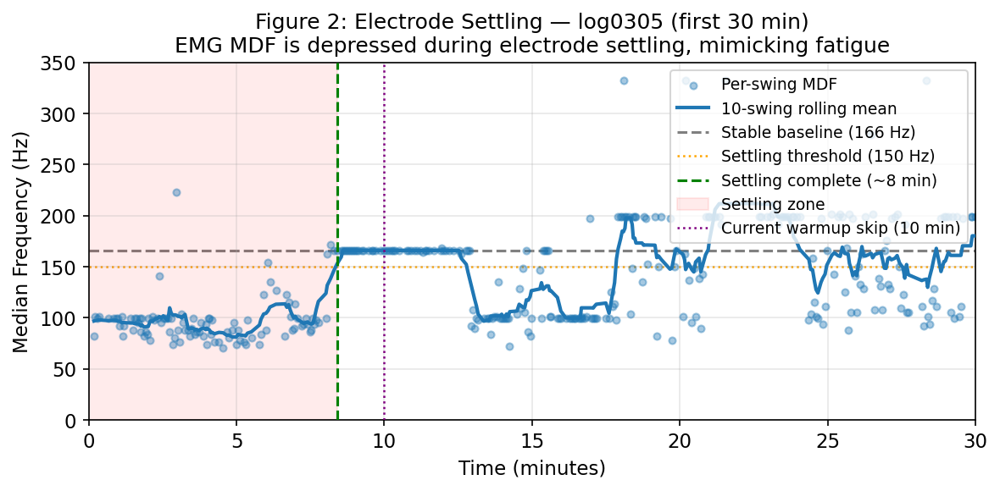
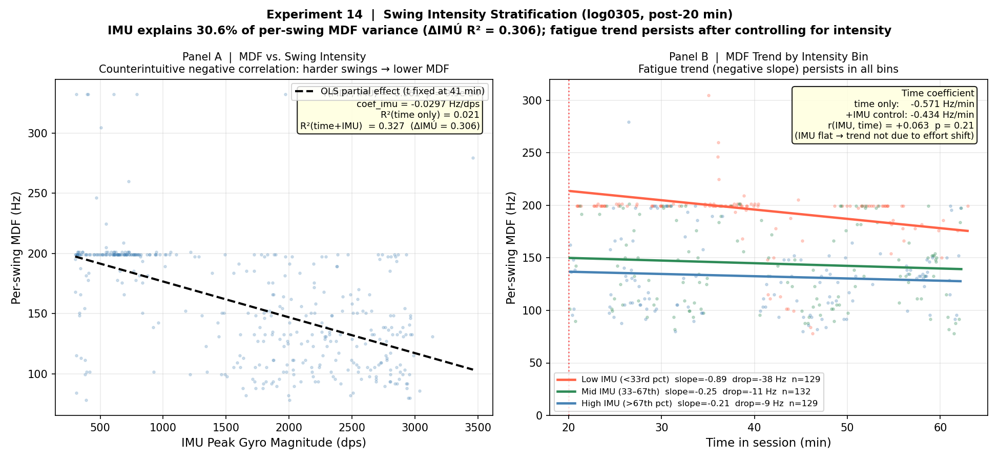

**Project Title:**
**SmartArmor: A Low-Cost Wearable AI System for Personalized Forearm Fatigue Monitoring and Overuse-Risk Awareness in Youth Tennis Players**

**Team:** Ryan Wang
**Mentor:** Xiaodong Wang
**Division:** Senior Division | **Track:** Research & Innovation — AI / Robotics

---

### 1. Project Objectives

Tennis elbow, shoulder impingement, and wrist tendinopathy are common overuse problems in youth
tennis. They often share a common mechanism: repeated arm load exceeding recovery capacity over
weeks and months. Most young athletes only realize their arm is overloaded once soreness
appears — when recovery may already require reduced training.

This project has three objectives:

1. **Build** a low-cost wearable sensor system (under $50) that can record muscle electrical
   signals (EMG) and motion data (IMU) from a tennis player's forearm during real practice sessions.

2. **Analyze** those signals to extract objective biomarkers of forearm fatigue — metrics that
   estimate local muscle fatigue, not just how tired the player feels.

3. **Train a personalized AI model** that learns how one player's forearm load relates to
   next-morning soreness and next-session readiness, enabling earlier load-management decisions.

The ultimate goal is a system that can tell a young athlete: *"Your forearm load is unusually high
compared with your recent recovery pattern. Consider rest or reduced serving volume today."* No
doctor visit, no expensive equipment, no guessing.

---

### 2. Background & Motivation

Upper-extremity overuse injuries are common in competitive youth tennis. Lateral epicondylitis,
shoulder impingement, and wrist tendinopathy often involve the same load-management problem:
cumulative arm load exceeding recovery capacity over days to weeks. Unlike acute injuries, overuse
can build gradually — a player may feel fine after one session but develop soreness after repeated
high-load practices without adequate recovery.

Existing tools fail youth athletes at both ends: professional EMG systems (Delsys Trigno, Noraxon)
cost $8,000–$15,000 and require lab setup; consumer trackers (Apple Watch, Garmin) measure heart
rate but cannot detect muscle-specific forearm fatigue — a more local signal related to the arm
structures stressed in tennis elbow.

**The science:** When a muscle fatigues, the frequency content of its EMG signal often shifts lower, causing the
Median Frequency (MDF) to decrease measurably — a well-established fatigue marker (Merletti & Parker, 2004).
In dynamic sports like tennis, however, standard EMG analysis breaks down: swings are fast,
non-repetitive, and artifact-prone. Because dry-electrode EMG can also drift during sweat and
motion, SmartArmor scores each session for signal quality before using any data for AI — bad
sessions flagged as low quality are excluded or reviewed before AI training.

For youth players, developing tissues and growth plates make load management especially important.
A low-cost system that flags rising forearm load and declining readiness before soreness escalates
would be transformative for any young athlete whose family cannot afford sports medicine monitoring.

---

### 3. Methodology / Technical Approach

SmartArmor has three layers: (1) a wearable sensor node, (2) a signal processing pipeline, and
(3) a personalized AI model. Figure 1 shows the full architecture.

**Layer 1: Wearable Sensor Hardware**

Off-the-shelf components; prototype sensor node electronics BOM under $50 (excluding host phone/laptop):

- **MyoWare 2.0 EMG sensor** — surface electrode on the forearm extensor muscles
- **ICM-20948 9-axis IMU** — 3-axis accelerometer + gyroscope for swing detection and load quantification
- **ESP32 microcontroller** — streams data via Bluetooth Low Energy (BLE) at 2,000 Hz (EMG) and 200 Hz (IMU)
- **LiPo battery** — 6–8 hours per charge

*Figure 1. System architecture: MyoWare 2.0 EMG + ICM-20948 IMU → ESP32 → BLE → laptop/Android for capture, processing, and AI readiness prediction.*

**Layer 2: Signal Processing**

Custom software on a laptop or Android phone processes the BLE stream:
Both RAW and envelope EMG channels are recorded — RAW is required for frequency-domain biomarkers
such as MDF, while the envelope supports live signal-quality checks. EMG is bandpass filtered
(20–450 Hz), notch filtered (60 Hz), and envelope-extracted. The IMU gyroscope detects each
tennis swing automatically (peak > 300°/s), enabling per-swing analysis rather than treating the
whole session as one signal. Each session is quality-scored (usable / questionable / reject) based
on contact drift and artifact level — bad sessions are excluded from AI training. Each swing
yields an 18-feature vector: EMG time-domain (RMS, MAV, waveform length), frequency-domain
(MDF, mean frequency, spectral slope), envelope statistics, and IMU kinematics (peak
acceleration, peak angular velocity, rotational load).

**Layer 3: Personalized AI**

AI is needed because forearm load is not captured by one signal alone: EMG frequency, EMG
amplitude, swing intensity, stroke count, recovery spacing, and prior soreness all interact
differently for each player. Two components work together:

*Component A — Per-swing load index:* A Random Forest model assigns each swing a load score
based on its time position in the session (early = low load, late = high load), calibrated
against the player's post-session exertion ratings. Six session-level summaries are produced:
late-session load depth, high-load swing fraction, load onset timing, load slope, EMG/IMU
disagreement rate, and model confidence.

*Component B — Cross-session readiness regression (main AI contribution):* An elastic net
regression trained on 40+ sessions takes Component A summaries plus workload features
(stroke count, serve-specific gyro impulse, acute-to-chronic load ratio) and predicts:
**next-morning forearm soreness** (0–10) and **next-session readiness** (1–5). The player
rates these via a 2-minute phone survey after each session. The model learns *their* specific
load-to-recovery pattern — not a population average.

**Stroke-aware load:** SmartArmor estimates serve-like versus groundstroke-like swings from IMU
peak patterns. Serve-like swings show higher rotational impulse in pilot data, so their load is
tracked separately from generic swing count. Video annotation is planned to quantify
classification accuracy; until then, stroke-type separation is treated as exploratory.

**Data collected to date:** Multiple real practice sessions captured, EMG and IMU time-aligned
to within 1 ms. Swing detection and quality scoring are working. MDF fatigue-consistent trends
confirmed in pilot sessions (Figure 2). Session-level load summaries show early correlation
with post-session forearm exertion ratings. Longitudinal collection (target: 40–60 sessions)
is ongoing.

*Figure 2. MDF three-phase trajectory (63 min session, 826 swings): Phase I settling (0–21 min), Phase II stable reference at 166 Hz (21–42 min), Phase III fatigue-consistent decline to 149 Hz (42–63 min). IMU swing intensity remains approximately stable across phases, suggesting the late-session MDF decline reflects muscle fatigue rather than reduced effort; ongoing impedance and quality-control checks separate physiological fatigue from electrode drift.*

The longitudinal dataset collection (40–60 sessions for AI model training) is ongoing.

---

### 4. Key Innovation

SmartArmor is designed to combine five elements that are rarely available together in youth-sports
monitoring: low-cost forearm EMG, real-tennis data capture, session quality scoring, stroke-aware
load tracking, and personalized readiness modeling.

**Innovation 1: Low-cost ecological validity**

SmartArmor's sensor node costs under $50 in electronics BOM and works during actual practice —
not only in lab isometric contractions — enabling quality-controlled EMG data collection across a
full competitive season.

**Innovation 2: Quality-aware processing**

Dry electrodes in sports settings can produce noisy, artifact-prone signals. SmartArmor explicitly
detects and flags bad sessions — and quantifies what would happen if bad data were included in
the model. This quality-aware design makes the AI more trustworthy than a pipeline that treats
all sensor data as equally reliable.

**Innovation 3: Stroke-aware load accounting**

By estimating serve-like versus groundstroke-like load from IMU patterns, the system tracks
high-rotation swing load separately from generic swing count. Video annotation is planned to
validate this separation; preliminary data shows serve-like swings carry higher rotational
impulse than groundstrokes.

**Innovation 4: Personalized intra-to-inter session AI**

The central novelty is bridging *within-session* load depth to *next-session* readiness. Most
fatigue detection research asks "is this athlete tired right now?" SmartArmor asks a more
actionable question: "given how loaded the arm was during today's session, how recovered is the
player likely to be tomorrow?" This session-to-session prediction loop, trained on an individual
player's own data, is the key research novelty of SmartArmor.

---

### 5. Results / Findings

**A. Completed: prototype and signal validation**

- BLE streaming, time-alignment (~1 ms), swing detection, and session quality scoring all working in real practice conditions
- MDF shows fatigue-consistent downward trends in the late session phase after electrode settling (Figure 2)
- Within-session MDF CV ~39–47%: tennis swings are highly non-stationary, confirming a single threshold cannot work
- In pilot data, motion artifact correlation between IMU magnitude and EMG envelope was low (r ≈ 0.006), suggesting EMG captures muscle activation rather than arm motion

**B. Preliminary: load-index and session-level features**

The per-swing Random Forest is used as a weak-label load estimator — not a standalone fatigue
classifier. Its session-level summaries (late-session load depth, high-load swing fraction, load
slope) show early correlation with post-session forearm exertion ratings. Preliminary data shows
serve-like swings carry higher rotational impulse than groundstrokes; video annotation is planned
to confirm stroke-type accuracy.

*Figure 3. Per-swing MDF vs. time in session, stratified by IMU swing intensity. The MDF decline over time persists consistently across low-, mid-, and high-intensity swing groups, suggesting the within-session load trend is not explained solely by effort variation.*

**C. In progress: longitudinal readiness model**

After 40+ valid sessions, we will test whether EMG + IMU load biomarkers outperform volume-only
baselines for predicting next-morning soreness (target: r > 0.5, RMSE < 1.5) and next-session
readiness (target: ΔR² > 0.05 over best volume baseline).

---

### 6. Impact / Future Development

**Immediate impact:** Any youth tennis player with a smartphone and a $50 sensor kit could monitor
their own forearm load and receive readiness guidance before their next practice —
accessible to club players, school teams, and self-coached athletes with no sports medicine staff.
Parents can make informed rest decisions after tournaments. Coaches gain an objective load signal
to review each session, enabling intelligent load management before injury warning signs appear.

**Broader applicability:** The same quality-aware EMG/IMU approach could be adapted to other
repeated-load sports such as baseball pitching, volleyball spiking, swimming, badminton, squash,
and pickleball. Each sport would require its own sensor placement and movement-detection
validation, but the core idea — local muscle sensing, motion load, quality scoring, and
personalized recovery modeling — is sport-agnostic.

**Development roadmap:** (1) Complete 40–60 session dataset and validate the readiness model;
publish findings. (2) Miniaturize into a production PCB sleeve with a mobile app. (3) Pilot
with 3–5 youth players to test generalization. (4) Open-source the full hardware and software.

The long-term vision is to give every young athlete an affordable early-warning signal for rising
forearm load and declining recovery — so rest decisions can be made before soreness becomes a
long-term problem.

---

### References

1. Foster, C. et al. (2001). A new approach to monitoring exercise training. *Journal of Strength and Conditioning Research*, 15(1), 109–115.
2. Merletti, R., & Parker, P. (2004). *Electromyography: Physiology, Engineering, and Noninvasive Applications.* IEEE Press / Wiley.
3. Gabbett, T. J. (2016). The training-injury prevention paradox: should athletes be training smarter and harder? *British Journal of Sports Medicine*, 50(5), 273–280.
4. Rota, S. et al. (2014). Fatigue and recovery in tennis. In *Tennis Medicine* (pp. 311–325). Springer.
5. Phinyomark, A. et al. (2018). EMG feature evaluation for improving myoelectric pattern recognition robustness. *Expert Systems with Applications*, 112, 403–422.
