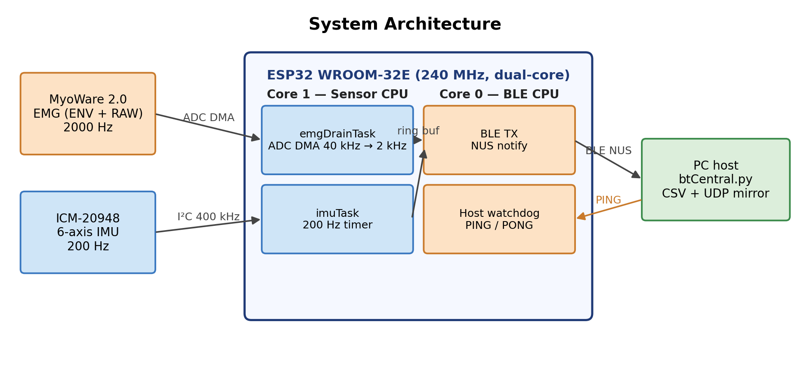
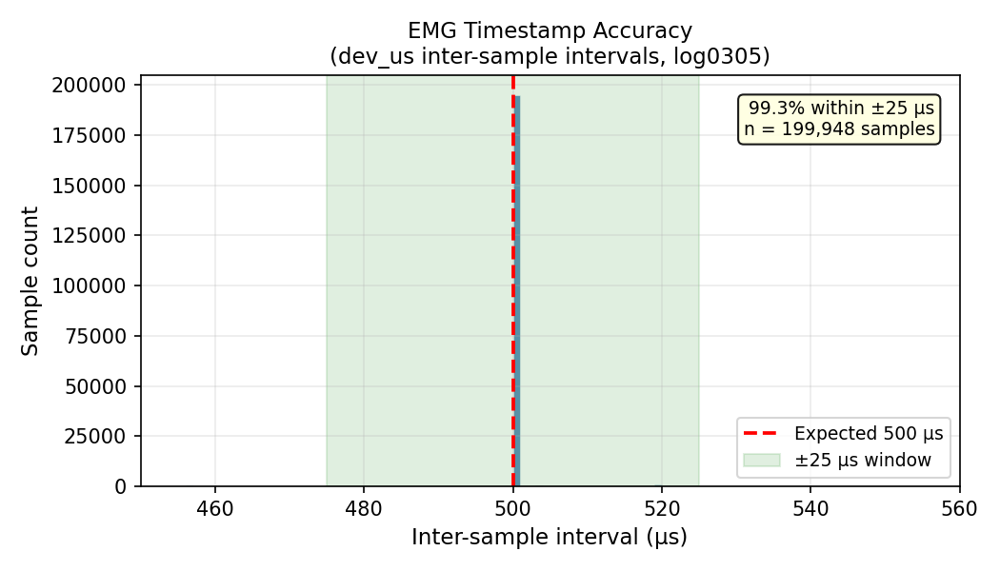
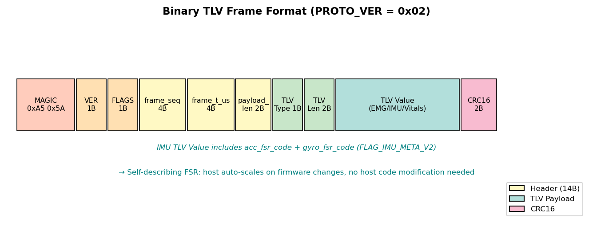
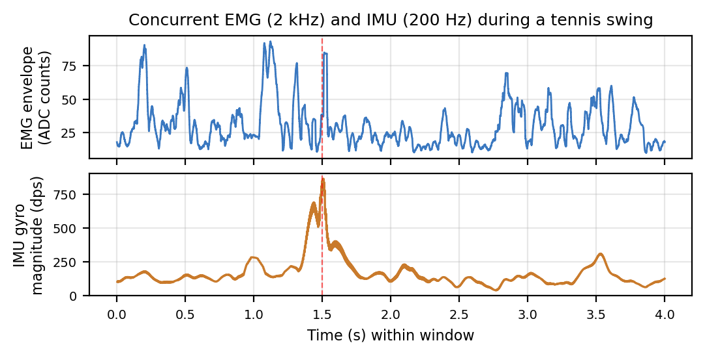

---
output:
  pdf_document:
    pandoc_args: ["--pdf-engine=xelatex"]
keywords: "wearable, EMG, IMU, BLE, ESP32, DMA, real-time, biosignal"
header-includes:
  - \usepackage{hyperxmp}
---

# A Robust Self-Describing BLE Platform for Real-Time Wearable EMG–IMU Sensing

**Ryan Wang** — Westview High School, San Diego, CA, USA
**Theodore Di** — Crescent Valley High School, Corvallis, OR, USA
**Dr. YanMing Di** — Professor, Department of Statistics, Oregon State University, Corvallis, OR, USA

*2026*

## Abstract

Monitoring muscle activity and body motion together reveals how neuromuscular effort evolves during athletic movement — in tennis, for example, fatigue manifests as greater muscle activation required to produce the same swing. Surface electromyography (EMG) records the electrical activity of contracting muscles, capturing effort and fatigue before they are visible in motion; an inertial measurement unit (IMU) records the acceleration and rotation of the moving limb. Research-grade systems that capture both reliably cost $5,000–$30,000, while commodity-microcontroller alternatives are affordable but rarely survive the timing, wireless, and physical-contact failures of real field deployment.

We present a $99 ESP32-based wearable that streams concurrent EMG and IMU data over Bluetooth Low Energy (BLE) with tens-of-microseconds timing accuracy and field-tested reliability. A dual-core architecture dedicates one CPU core entirely to sensor acquisition while the other handles wireless transmission, preventing BLE processing from interrupting sample collection. Analog-to-digital (ADC) sampling with direct memory access (DMA) at 20 kHz per channel, decimated 10× in software, yields a 2 kHz EMG output stream with per-sample timestamp accuracy of ±25 µs, empirically verified across 2.3 million samples. A self-describing binary frame format embeds sensor-range metadata in every packet so firmware gain changes do not break host parsers, and a two-layer device/host watchdog with hybrid timeline reconstruction recovers from BLE dropouts and full device resets without data corruption. Across 150+ minutes of tennis field recording, the system showed zero detected sample drops. We also document a field-discovered hardware failure — a pogo-pin contact producing a "ghost" signal that mimics real EMG until filtering reveals it as flat — together with a quantitative diagnostic and solder-bypass fix. By delivering accurate, time-aligned biosignal streams from a robust low-cost platform, this work supports the downstream signal processing, data fusion, and intelligent movement-analysis pipelines targeted by ICPICS. Although demonstrated in tennis, the platform is application-agnostic and supports a broad range of wearable biosignal use cases.

## I. Introduction

Surface electromyography (EMG) and inertial measurement (IMU) together address a central question in athletic fatigue monitoring: *is the muscle working harder to produce the same motion?* Tennis is one well-studied case where prolonged practice alters upper-limb muscle activity and degrades stroke performance [1]; the hardware and capture pipeline are however application-agnostic and apply equally to rehabilitation assessment, gesture recognition, occupational ergonomics [2], or e-sports performance monitoring.

Commercial research-grade systems (e.g., Delsys Trigno [7], Noraxon Ultium [8]) capture EMG and IMU reliably with sub-millisecond synchronization, but at $5,000–$30,000 per unit they are out of reach for youth sport and most field research outside well-funded laboratories. The principal barrier is engineering effort — sensing modalities and microcontroller hardware are inexpensive — and a low-cost alternative becomes feasible once the timing, wireless, and physical-contact failure modes are addressed systematically.

Low-cost alternatives based on commodity microcontrollers face three practical challenges: (i) achieving 2000 Hz EMG sampling without sample loss requires careful ADC architecture, since naive timer-based sampling at this rate consumes excessive CPU and competes with the Bluetooth stack; (ii) reliable BLE streaming at the combined EMG + IMU data rate demands efficient packetization and reconnection handling; (iii) multi-sensor systems require precise timestamp alignment across sensors with different sampling rates (2000 Hz vs. 200 Hz). Prior low-cost wearable EMG systems [4,5,6] typically achieve adequate sampling in controlled laboratory settings but rarely document the failure modes encountered in field deployment — pogo-pin routing failures, ADC crosstalk, BLE reconnection, and timestamp drift.

This paper presents the design and field validation of a complete $99 wearable EMG–IMU acquisition system. Our contributions span firmware, protocol, and capture-pipeline engineering:

1. **Reliable high-rate EMG sampling.** ADC samples stream directly to memory without CPU involvement; 20 kHz per-channel acquisition decimated 10× in software, combined with per-sample timestamp reconstruction, yields ±25 µs accuracy at the 2 kHz output rate, empirically validated over 2.3 million samples.
2. **Protocol robustness across firmware changes.** A self-describing BLE frame format embeds IMU full-scale-range codes in every frame, enabling firmware parameter updates without host decoder changes — demonstrated unchanged across three firmware FSR revisions.
3. **Concurrent sensing without wireless interference.** A dual-core FreeRTOS architecture with explicit task-priority assignment achieves zero detected sample drops during concurrent EMG (2 kHz) + IMU (200 Hz) BLE streaming, evaluated across 150+ minutes of field recordings.
4. **Recovery from field interruptions.** A two-layer device/host watchdog (device-side pause at 18 s, reboot at 30 s) combined with host-side hybrid timeline reconstruction (`abs_us`) handles BLE-dropout and ESP32-reset cases; field testing demonstrated clean recovery from an inter-run reconnect without file corruption or parser failure.
5. **Physical-contact failure diagnosis.** A pogo-pin ADC ghost signal consistent with charge sharing or floating-input coupling (r = 0.998 with the envelope channel) that survives visual inspection but is silently destroyed by routine high-pass filtering, with quantified diagnosis and a reproducible solder-bypass fix.

## II. Related Work

**Commercial and low-cost wearable EMG.** Lab-grade systems (Delsys Trigno [7], Noraxon Ultium [8]) provide research-quality EMG with sub-millisecond synchronization but are inaccessible at \$5,000–\$30,000 per unit, and their proprietary pipelines provide little reproducible engineering reference. Low-cost academic systems are more open: Cerone et al. [4] presented a modular HD-sEMG system with detailed analog front-end design but limited documentation of the BLE capture pipeline; Lynn et al. [9] validated the Athos compression-shirt platform but treated the underlying acquisition system as a black box; Yang et al. [6] surveyed e-textile EMG sensors with focus on electrode design rather than capture-pipeline engineering. These works generally do not document timestamp accuracy or BLE reliability metrics required for unattended multi-session field recording.

**IMU–EMG fusion and engineering documentation gap.** Taborri et al. [3] surveyed inertial-and-EMG sensors for sports biomechanics; Bangaru et al. [2] document construction-worker fatigue capture but rarely the firmware or protocol that collected it. The MultiSenseBadminton dataset [10] provides multi-modal sport recordings but does not describe the engineering decisions that made robust capture possible. More broadly, most published BLE biosignal systems report scientific results without describing reconnection robustness, multi-clock timestamp reconstruction, or on-device protocol-evolution strategies — magic-byte resync, exponential-backoff reconnection, hybrid device/host timeline reconstruction — leaving these details to firmware repositories rather than the published record. Few low-cost wearable EMG systems document the full stack from firmware DMA design through BLE protocol to field-validated reliability metrics for a concurrent 2 kHz EMG + 200 Hz IMU wearable, including a quantitative analysis of physical-contact failure modes encountered in real deployment.

## III. System Architecture

### A. Hardware

The system uses five components totaling approximately $99 USD (Table I). The MyoWare 2.0 muscle sensor provides both a hardware-rectified envelope output (ENV) and a raw AC-coupled output (RAW) on separate pins, essential for concurrent amplitude and spectral EMG analysis.

**Table I.** Bill of Materials.

| Component | Function | Sampling Rate | Approx. Cost |
|:---|:---|:---|---:|
| MyoWare 2.0 | EMG (ENV + RAW) | 2000 Hz | $40 |
| ICM-20948 | 6-axis IMU | 200 Hz | $15 |
| MAX30105 | SpO2 / Heart Rate (optional) | ~0.03 Hz | $10 |
| MAX17048 | Battery fuel gauge | 0.1 Hz | $5 |
| ESP32 WROOM-32E | MCU + BLE | 240 MHz, dual-core | $12 |
| PCB / battery / wiring | Integration | — | ~$17 |
| **Total** | | | **≈ $99** |

The MAX30105 (SpO2/HR) and MAX17048 (battery gauge) are included for extensibility and device monitoring; the present evaluation focuses on EMG and IMU acquisition and the SpO2/HR channel is not part of the contributions reported here.

A field-discovered hardware issue: the MyoWare Wireless Shield routes the RAW signal through spring-loaded pogo pins to ESP32 GPIO 32. Under movement, pogo contact is unreliable, producing a ghost signal on the RAW channel that is highly correlated with ENV (r = 0.998), consistent with ADC multiplexer charge sharing or floating-input coupling — the floating RAW input appeared to track the previously sampled ENV voltage. After filtering, the ghost signal flatlines, causing silent loss of usable RAW spectral EMG. The fix is a direct solder jumper from the MyoWare RAW pad to GPIO 32 (ADC1 channel 4). Post-fix, the RAW channel shows the expected AC EMG waveform during contraction.

### B. Dual-Core FreeRTOS Architecture

The ESP32 dual-core architecture enables strict separation of real-time sensor acquisition from BLE protocol processing. Fig. 1 shows the task allocation.

**Core 1 (Sensor CPU):** Three tasks run concurrently:
- `emgDrainTask` (priority 2): drains ADC DMA buffer, decimates 10× to 2000 Hz, writes to ring buffer
- `imuTask` (priority 2): reads ICM-20948 at 200 Hz via timer-triggered I2C
- `spo2Task` (priority 0): computes SpO2/HR every ~30 seconds in background

**Core 0 (Protocol CPU):** `loop()` handles BLE notifications, host watchdog, LED state machine, and battery monitoring. This separation prevents BLE stack processing from interrupting sensor acquisition.

Task priority 2 for both `emgDrainTask` and `imuTask` was selected after observing that priority 1 allowed `spo2Task` I2C operations to occasionally starve IMU reads — a non-obvious interaction in FreeRTOS that is documented here to benefit other practitioners.

## IV. Signal Acquisition

### A. ADC DMA Oversampling

Timer-based ADC sampling at 2000 Hz would require 2000 ISR calls per second per channel, competing with FreeRTOS scheduling overhead. Instead, we use the ESP32 ADC Continuous (DMA) driver configured for 40,000 total conversions/s across the two channels (ENV and RAW), yielding 20,000 conversions/s per channel; *emgDrainTask* then applies 10× software decimation to produce the 2,000 Hz output rate per channel.

The DMA frame size is 256 bytes (64 results × 4 bytes each), covering 1.6 ms of acquisition — well within FreeRTOS task scheduling jitter. *emgDrainTask* is notified by DMA completion and drains frames from a circular DMA buffer.

### B. Per-Sample Timestamp Back-Calculation

A key challenge is that DMA frame completion notification may arrive up to 16 ms after the actual last sample in the frame. We correct this using the known frame duration: for each DMA frame of *N* samples drained at the ESP32 timer reading *tend*, the *i*-th sample's timestamp is back-calculated as *tend* − (*N* − *i*) · *T*, where *T* = 500 µs is the per-sample period. Fig. 2 shows the empirical inter-sample interval distribution across 2.3 million samples from a 131.7-second field session: 99.03% of samples fall within ±25 µs of the expected 500 µs interval, with 97.7% at exactly 500 µs. The p99.9 outliers (925 µs) correspond to DMA buffer stalls during brief BLE TX bursts and represent < 0.1% of samples.

### C. Multi-Sensor I2C Bus Management

The IMU, SpO2, and battery gauge share a 400 kHz I2C bus serialized by a FreeRTOS mutex (`wireMutex`) across `imuTask`, `spo2Task`, and `loop()`; ICM-20948 reads at 200 Hz consume ~3% of bandwidth, leaving ample margin.

## V. Protocol Design

### A. Binary TLV Frame Format

Fig. 3 shows the binary frame format (all multi-byte fields little-endian). The 14-byte header contains: 2-byte magic (0xA5 0x5A), protocol version, flags, 4-byte sequence number, 4-byte frame timestamp (32-bit µs, host-extended to 64-bit), and 2-byte payload length. A CRC16-CCITT checksum over header + payload enables corruption detection. Three TLV types — `TLV_EMG_BATCH (0x01)`, `TLV_IMU_BATCH (0x02)`, `TLV_VITALS (0x03)` — can be concatenated for batched sensor data.

### B. Self-Describing Sensor-Metadata Protocol

A practical problem in iterative firmware development: when the IMU full-scale range (FSR) setting changes (e.g., gyroscope ±250 → ±1000 → ±2000 dps to prevent saturation during hard tennis swings), the host decoder must apply the correct scale factor; hardcoding the FSR creates brittle coupling. Our solution: every `TLV_IMU_BATCH` frame includes `acc_fsr_code` and `gyro_fsr_code` when `FLAG_IMU_META_V2` is set. The host maps these codes to physical scale factors at runtime (`ACC_FSR_CODE_TO_G = {0:2, 1:4, 2:8, 3:16}`; `GYRO_FSR_CODE_TO_DPS = {0:250, 1:500, 2:1000, 3:2000}`). This design was validated across the three FSR revisions in Table II with no host decoder changes required.

**Table II.** IMU full-scale-range (FSR) revisions across firmware iterations.

| Firmware revision | Gyro FSR | Acc FSR | Gyro code | Acc code | Reason for change |
|:---|:---:|:---:|:---:|:---:|:---|
| v1 (initial) | ±250 dps | ±2 g | 0 | 0 | ICM-20948 default; saturated on hard tennis swings |
| v2 (mid-development) | ±1000 dps | ±4 g | 2 | 1 | Reduce gyro saturation; still occasional acc clipping |
| v3 (current, since 2026-03-03) | ±2000 dps | ±8 g | 3 | 2 | Eliminate saturation across all observed swings |

### C. Host Watchdog with Graceful Degradation

Unattended field recording requires the device to recover from host disconnection or BLE stack hangs. We implement a three-state watchdog driven by host PINGs (sent every ~1 s via the BLE RX characteristic): **Normal** (< 18 s since last PING) — streaming active; **Pause** (18–30 s) — ADC DMA stopped (~40 mA current reduction observed), IMU and SpO2 suspend; **Reboot** (> 30 s) — hardware reset, BLE advertising restarts automatically. This was exercised during a between-run BLE reconnect in field sessions totaling over 150 minutes, with no detected sample drops in active-stream segments and no file corruption after reconnection.

## VI. Host Capture Pipeline

The PC host receiver (`btCentral.py`, built on Bleak) uses an asynchronous task pipeline: the BLE callback enqueues raw bytes onto an `asyncio.Queue`, a consumer task drains the queue in batches, a `FrameParser` re-synchronizes on the 0xA5 0x5A magic bytes and validates each frame's CRC16, decoded TLVs are appended to in-memory row buffers, and a writer task flushes buffers to disk every 2 s. Captured frames are logged to time-rotating CSV files (`emg_log_<session>_<idx>.csv`, `imu_log_<session>_<idx>.csv`, default 30 min per segment), each with a sidecar `.meta.json` (FSR codes, sample rate, MAC, segment open/close times). Metadata files are written tmp-file-then-rename for atomicity. A best-effort UDP mirror feeds an optional real-time plotter without affecting the recording path.

A host-side watchdog complements the device-side watchdog: if no notifications arrive for 5 s, it first re-subscribes to NUS TX; if that fails, it triggers a full reconnect with exponential backoff (0.5 s → 20 s cap), flushing buffered rows beforehand. To handle the harder case — when the device itself reboots and its clock restarts — the host computes a hybrid `abs_us` timeline. Within a single BLE connection, `abs_us` follows the host-extended device timestamp `dev_us` (precise to ±25 µs from § IV.B). Between connections, `abs_us` advances by the difference in `host_rx_ms` across the gap. This rule unifies BLE-dropout and ESP32-reset cases without requiring the host to identify which occurred. Formal validation against `host_rx_ms` ground truth across the inter-run gap is deferred to an extended journal version.

## VII. Evaluation

### A. Timestamp Accuracy

As shown in Fig. 2 and Table III, empirical analysis of 2.3 million samples from a 131.7-second field recording confirms the ±25 µs timestamp accuracy claim. The 0.97% of samples outside ±25 µs are bounded within ±500 µs (99.96%), corresponding to brief DMA stalls during BLE TX bursts.

**Table III.** Inter-sample interval statistics (log0305, 2,324,791 samples).

| Metric | Value |
|:---|:---|
| Expected interval | 500 µs (2000 Hz) |
| Within ±25 µs | **99.03%** |
| Exactly 500 µs | 97.7% |
| Within ±500 µs | 99.96% |

### B. Data Throughput and Drop Rate

The combined data rate is approximately 12.5 KB/s (EMG: 8000 B/s, IMU: 2400 B/s, headers/CRC: ~2100 B/s), near BLE 4.2 capacity at MTU=244 with CONNECTION_PRIORITY_HIGH. Across two field sessions totaling 150+ minutes and 823 detected swings, sequence-number continuity analysis showed **zero detected EMG or IMU sample drops during active streaming**, with CRC error rate < 0.01%. The single between-run reconnect was handled without file corruption or parser lockup. Table IV summarizes per-session reliability metrics.

**Table IV.** Field validation summary.

| Session | Duration (min) | Swings | btCentral runs | Inter-run reconnects | Sample drops | CRC errors |
|:---|:---:|:---:|:---:|:---:|:---:|:---:|
| log0303 | 87.9 | 197 | 2 | 1 | 0 | <0.01% |
| log0305 | 63.1 | 626 | 1 | 0 | 0 | <0.01% |
| **Total** | **151.0** | **823** | **3** | **1** | **0** | **<0.01%** |

Fig. 4 illustrates the time-aligned concurrent acquisition: a 4-second window around a tennis swing shows EMG envelope amplitude rising in advance of the gyro-magnitude peak, demonstrating that 2 kHz EMG and 200 Hz IMU streams co-register on the platform's *abs_us* timeline.

### C. BLE Reconnection Robustness

One between-run BLE reconnect was observed across the field sessions (within log0303, session_id changed from `20260303_183639` to `20260303_191258`). Recording resumed cleanly into a new file series; the hybrid `abs_us` timeline correctly preserved the inter-run gap, enabling downstream analysis to detect session discontinuities rather than treating them as continuous data. Within-run BLE re-subscriptions (handled by the host watchdog without process restart) are deferred to the journal extension.

### D. Field Failure: Pogo-Pin Ghost Signal

Before the GPIO 32 solder bypass, the RAW channel exhibited a ghost signal with Pearson r = 0.998 vs. ENV and near-zero variance (SD < 5 ADC counts vs. expected 50–500 during contraction). After bandpass filtering (50–450 Hz), the ghost flatlined entirely. Post-bypass, RAW showed independent AC EMG oscillation (SD > 100 counts during contraction) and ENV-RAW correlation dropped to r = −0.013 for filtered signals. The diagnostic signature — high RAW–ENV correlation, near-zero RAW variance, post-filter flatline, disappearance after solder bypass — generalizes to any high-impedance analog input routed through a non-soldered contact and sampled on a multiplexed ADC.

### E. Data Collection and Consent

Field recordings were collected during normal tennis practice with non-invasive wearable sEMG/IMU sensors. Written informed consent was obtained from a parent/legal guardian; participant assent was obtained where applicable. Data were anonymized before analysis.

## VIII. Discussion

The pogo-pin failure mode is not specific to MyoWare. Any wearable that routes a high-impedance analog signal through a non-soldered contact (pogo pin, snap, spring contact, ZIF socket) and samples it on a multiplexed ADC is vulnerable; the diagnostic — Pearson correlation > 0.95 between channels that should be electrically independent, plus near-zero variance on one — should be checked in early field captures rather than trusting visual inspection, because high-pass filtering will silently destroy the ghost. The hybrid `abs_us` reconstruction has no MyoWare- or tennis-specific assumptions: any BLE logger that records both a device microsecond timestamp and a host millisecond receive time can apply the same two-case rule. The reconstruction gap is bounded by the BLE notification interval on the dropout end and the BLE advertising interval on the reset end.

**Limitations and future work.** Validation rests on a single sport, one subject, and 150+ minutes; broader subject and sport diversity are needed. The combined data rate (~12.5 KB/s) is near BLE 4.2 sustained throughput at MTU 244, so adding more sensors will require BLE 5.0 with 2M PHY. Formal validation of `abs_us` against `host_rx_ms` ground truth, AD5933-based on-board impedance monitoring, multi-device synchronized acquisition, and an Android Chaquopy port for on-device spectral analysis are deferred to a journal extension.

## IX. Conclusion

We presented a low-cost ($99) ESP32 wearable achieving reliable concurrent EMG (2000 Hz) and IMU (200 Hz) BLE streaming through five engineering contributions: DMA-driven oversampling ADC with ±25 µs timestamp accuracy (99.03% of 2.3 M samples), self-describing sensor-metadata protocol surviving three firmware revisions, dual-core FreeRTOS architecture with zero detected sample drops, two-layer device/host watchdog with hybrid timeline reconstruction for unattended field sessions, and quantitative diagnosis and repair of a pogo-pin ghost-signal failure mode. Field-tested across 150+ minutes of sports deployment, the system provides a reproducible low-cost platform for wearable biosignal acquisition research. By delivering accurate, time-aligned EMG–IMU streams at low cost, the platform serves as a building block for downstream signal processing, sensor-data fusion, and intelligent movement-analysis pipelines.

## References

[1] Rota S, Morel B, Saboul D, Rogowski I, Hautier C. "Influence of fatigue on upper limb muscle activity and performance in tennis." J Electromyogr Kinesiol. 2014;24(1):90–97.

[2] Bangaru SS, Wang C, Aghazadeh F. "Automated and continuous fatigue monitoring in construction workers using forearm EMG and IMU wearable sensors and recurrent neural network." Sensors. 2022;22(24):9729.

[3] Taborri J, et al. "Sport biomechanics applications using inertial, force, and EMG sensors: A literature overview." Appl Bionics Biomech. 2020;2020:2041549.

[4] Cerone GL, Botter A, Gazzoni M. "A modular, smart, and wearable system for high density sEMG detection." IEEE Trans Biomed Eng. 2019;66(12):3371–3380.

[5] Farago E, et al. "A review of techniques for surface electromyography signal quality analysis." IEEE Rev Biomed Eng. 2022;16:494–511.

[6] Yang K, et al. "E-textiles for sports and fitness sensing: current state, challenges, and future opportunities." Sensors. 2024;24(4):1058.

[7] Delsys Inc. "Trigno Wireless EMG System — Technical Specifications." Natick, MA, USA, 2024.

[8] Noraxon USA. "Ultium EMG Sensor System — Product Documentation." Scottsdale, AZ, USA, 2024.

[9] Lynn SK, Watkins CM, Wong MA, Balfany K, Feeney DF. "Validity and reliability of surface electromyography measurements from a wearable athlete performance system." J Sports Sci Med. 2018;17(2):205–215.

[10] Seong M, Kim G, Yeo D, et al. "MultiSenseBadminton: Wearable sensor-based biomechanical dataset for evaluation of badminton performance." Sci Data. 2024;11:343.
