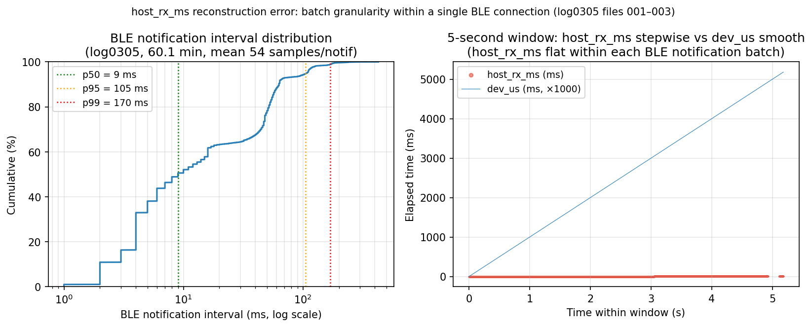
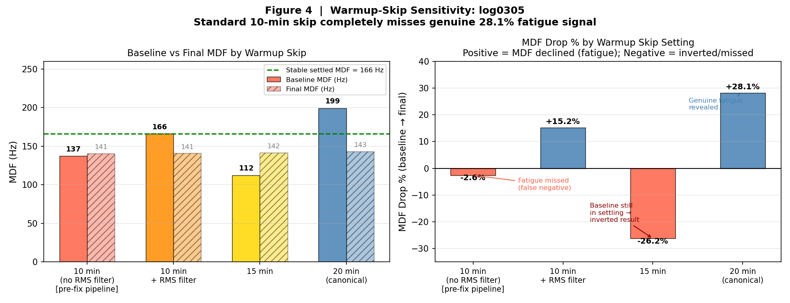
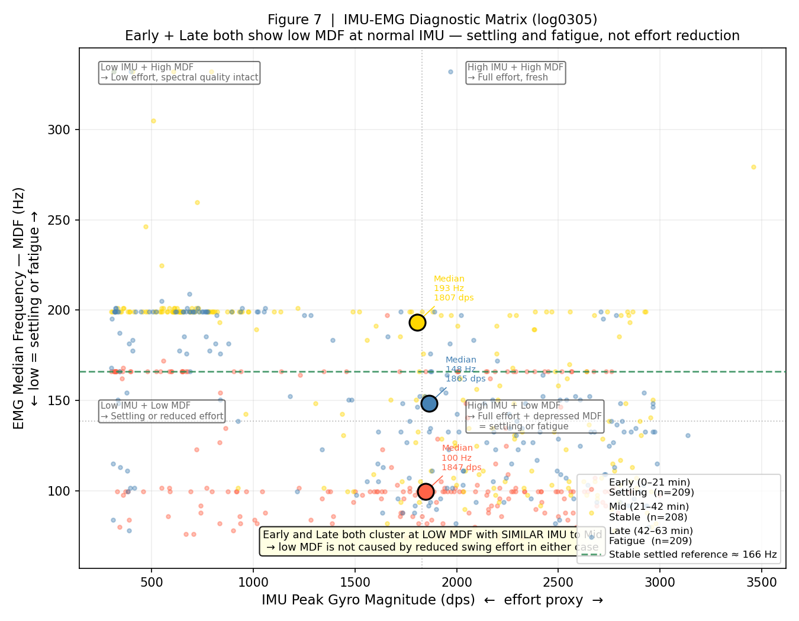
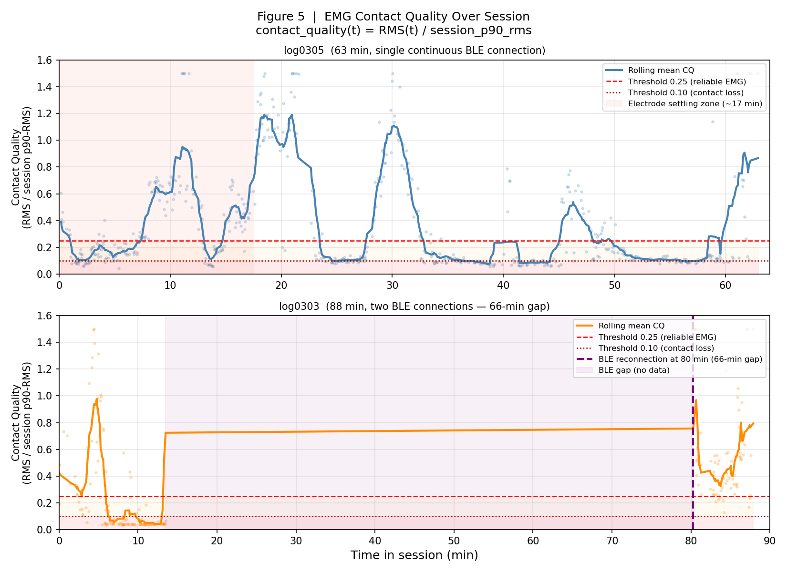
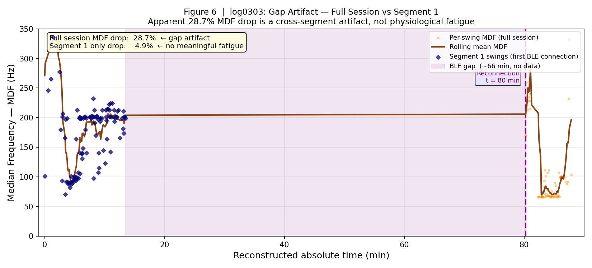
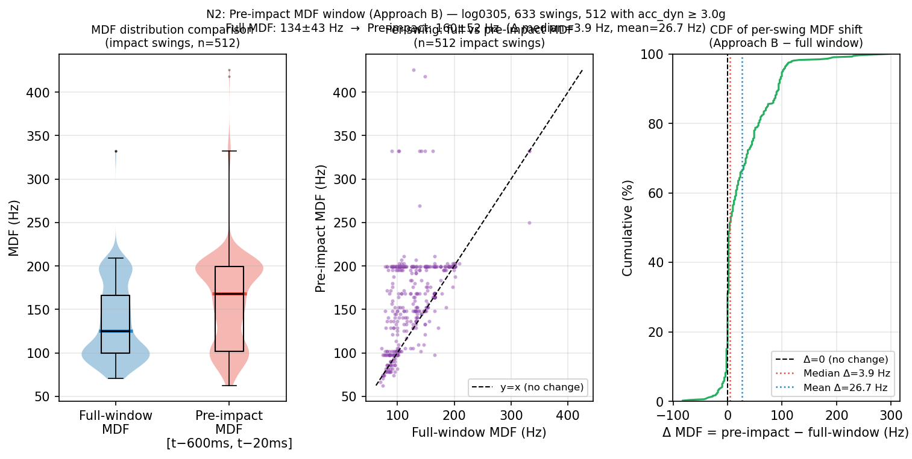

<!-- SOURCE MAP:
  §1 = paper_cnib §1 + icpics_draft_long §I + new combined thesis
  §2 = paper_cnib refs [1-15] + icpics_draft_long §II + journal_n4_comparative.md
  §3 = paper_cnib §2 + icpics_draft_long §III-VI
  §4 = paper_cnib §3 + new §4.8 (N2)
  §5 = paper_cnib §4.5 + icpics_draft_long §VII + new §5.4 (N1)
  §6 = paper_cnib §4.1-4.4 + new §6.6 (N2), §6.7 (N3 TODO)
  §7 = paper_cnib §5 + icpics_draft_long §VIII + combined coupling narrative
-->

---

## 1. Introduction

Surface electromyography (sEMG) can quantify local muscle fatigue through spectral metrics
such as median frequency (MDF) and mean frequency (MNF), which shift toward lower values as
conduction velocity decreases with metabolite accumulation. Tennis players can often perceive
general tiredness, but subjective perception is not a quantitative, muscle-specific measure of
local fatigue. Objective EMG monitoring may complement perception by enabling session-to-session
workload tracking and future overuse-risk assessment — upper-extremity tennis injuries are
frequently chronic and repetitive, and lateral elbow tendinopathy is associated with repeated
forearm muscle loading [@aaos2023].

However, a player may maintain swing speed through compensation even as local forearm muscle
physiology changes, making external kinematics an insufficient proxy. In real court deployment,
gel electrode preparation is impractical: gel smears during play and affects racket grip, and
players resist pre-session preparation. This study intentionally evaluates a no-added-gel,
field-deployable configuration because routine on-court monitoring requires fast setup and
minimal interference with play — contrasting with SENIAM-style laboratory preparation where
skin preparation and gel are recommended [@hermens2000].

Commercial research-grade systems (e.g., Delsys Trigno [@delsys2024], Noraxon Ultium [@noraxon2024]) capture
EMG and IMU reliably but at $5,000–$30,000 per unit are out of reach for youth sport and most
field research. Low-cost alternatives based on commodity microcontrollers face three practical
challenges: (i) achieving 2000 Hz EMG sampling without sample loss requires careful ADC
architecture; (ii) reliable BLE streaming at the combined EMG + IMU data rate demands
efficient packetization and reconnection handling; (iii) multi-sensor systems require precise
timestamp alignment across sensors with different sampling rates (2000 Hz vs. 200 Hz).
Prior low-cost wearable EMG systems [@cerone2019;@lynn2018;@yang2024] typically achieve adequate sampling in controlled
laboratory settings but rarely document the failure modes encountered in field deployment.

Existing IMU–EMG wearable studies typically fuse both modalities as feature sources for
activity or fatigue classification [@taborri2020;@bangaru2022]. In contrast, this work uses the IMU as an
**independent biomechanical context sensor** for EMG validity assessment. Because tennis
swings generate repeatable forearm kinematic signatures, stable IMU swing intensity provides
a reference: when EMG changes while IMU is stable, the cause — electrode settling, contact
degradation, or local muscle fatigue — can be inferred from temporal context.

**Combined contributions of this work:**
- (C1) Field characterization of electrode settling (≥17–20 min, no-gel forearm snap electrodes)
- (C2) Warmup-skip sensitivity as a required robustness audit for no-gel field sEMG
- (C3) Contact-quality-aware EMG interpretation (ENV/RAW amplitude ratio proxy)
- (C4) IMU-conditioned EMG validity framework (Table 1)
- (C5) Session-gap artifact detection (BLE continuity auditing via `abs_us` timeline)
- (C6) Low-cost ESP32 platform: DMA oversampling, self-describing TLV, two-layer watchdog
- (C7) Quantitative `abs_us` hybrid timeline validation (N1 — ±25 µs intra, p99 ≤ 170 ms inter)
- (C8) IMU-guided pre-impact MDF window (N2 — Approach B, physiologically motivated)
- (C9) Multi-subject generalization of three-phase MDF trajectory (N3 — **TODO**)

---

## 2. Related Work

### 2.1 Field vs. Laboratory sEMG Fatigue in Tennis

The majority of sEMG fatigue studies use laboratory settings with controlled contractions,
gel electrodes, and stationary subjects. SENIAM guidelines [@hermens2000] provide electrode placement
and signal quality standards but were developed for controlled gel-electrode configurations;
forearm placement during dynamic sport is not addressed.

**Rota et al. 2014** [@rota2014] measured upper limb EMG (wrist extensors, deltoid, biceps) during
sustained tennis rally play in a controlled indoor setting using gel electrodes and a
commercial Bagnoli system. They report progressive MDF decline in wrist extensors over a
~25-minute session — a finding this work extends to a no-gel field setting with online swing
detection. Rota et al. did not address electrode settling artifacts, contact-quality monitoring,
or timestamp continuity; their laboratory setting made these unnecessary.

**Wang LH et al. 2019** [@wanglh2019] examined forearm muscle fatigue and skill level effects on serve
ball speed, using a surface EMG system with gel electrodes. They report MNF and MDF
differences between skill levels during fatiguing serves. The three-phase MDF trajectory we
report (§6.1) appears in their data as a "warm-up then fatigue" pattern but is not isolated
from electrode settling artifacts.

**Girard et al. 2011** [@girard2011] examined spinal and peripheral components of fatigue during
prolonged tennis play using neuromuscular testing at rest intervals. Their protocol required
laboratory apparatus not compatible with practice courts.

**Gap statement.** No prior work has characterized sEMG MDF fatigue trajectories under
no-gel field conditions with online swing detection, contact-quality monitoring, or
IMU-conditioned validity classification. The settling-aware three-phase methodology (§4),
the warmup-skip sensitivity analysis (§4.6), and the pre-impact MDF window (§4.8) are
novel contributions to the tennis sEMG fatigue literature.

### 2.2 Dry Electrode and Contact Quality

Dry electrodes are required for rapid field deployment where gel application is not practical.

**Joutsen et al. 2024** [@joutsen2024] characterized ECG signal quality in long-term dry electrode
recordings, showing that skin–electrode impedance decreases as sweat accumulates, with
practical implications for settling duration. This is the physical basis for the Phase I
settling behavior we report in §4.2.

**Boyer et al. 2023** [@boyer2023] reviewed techniques for reducing noise and artifacts in single-channel
EMG, with discussion of dry electrode contact quality and practical EMG reliability.

**Ravichandran et al. 2023** [@ravichandran2023] characterized impedance properties of dry e-textile electrodes,
including the effect of contact force and perspiration on electrode-skin interface behavior.

Our contact-quality metric (§4.7) uses the ENV/RAW amplitude ratio as a proxy for contact state,
avoiding the need for dedicated impedance circuitry.

### 2.3 IMU + EMG Integration

**Fusion vs. context.** Taborri et al. 2020 [@taborri2020] surveyed IMU + EMG integration in sports
biomechanics. Most fusion approaches treat the IMU as a signal to be combined with EMG at the
feature level. Our approach uses the IMU as *context* for EMG validity: the IMU provides swing
detection, ball-impact timing, and motion-state classification that determines which EMG windows
are interpretable. This "IMU-as-context" framework (§4.5) is distinct from fusion.

**Bangaru et al. 2022** [@bangaru2022] used IMU + EMG for construction worker fatigue monitoring in a
field setting, but their capture infrastructure did not require the engineering work described
here (reconnect robustness, timestamp continuity, BLE protocol design).

### 2.4 Wearable EMG–IMU Platforms: Engineering Comparison

<!-- SOURCE: journal_n4_comparative.md Table 1 — merge verbatim -->

**Table 1. Engineering comparison of wearable EMG platforms for field deployment.**

| Platform | Cost (USD) | EMG fs (Hz) | IMU fs (Hz) | Raw EMG | BLE robustness | Timeline reconstruction | Multi-platform | Open HW/SW |
|---|---|---|---|---|---|---|---|---|
| **This work** (ESP32, $99) | ~$99 | 2000 | 200 | Yes (RAW+ENV) | Self-describing TLV, CRC, two-layer watchdog | abs_us hybrid: ±25 µs within, p99 ≤ 170 ms across reconnect | PC + Android | Yes |
| Delsys Trigno [@delsys2024] | $5–30K | 2000 | 148.1 | Yes (proprietary) | Proprietary RF | Proprietary; reconnect not documented | PC only | No |
| Noraxon Ultium [@noraxon2024] | $5–20K | 2000 | 200 | Yes (proprietary) | Proprietary BLE/ANT+ | Proprietary | PC only | No |
| Cerone HD-sEMG [@cerone2019] | Research | 2048 | — | Yes (HD-sEMG) | Undocumented | Not documented | PC | Partial |
| Lynn/Athos [@lynn2018] | ~$500–2K | 200 | Yes | No (ENV only) | Closed system | Not documented | Mobile | No |
| Yang e-textiles [@yang2024] | Varies | Varies | Varies | Depends | Not documented | Not documented | Varies | Research |
| MultiSenseBadminton [@seong2024] | ~$500–1K | — | 200–1000 | — (no EMG) | Not documented | Camera sync | PC | Dataset only |

Key differentiators: (1) $99 cost vs. $5–30K for research-grade systems; (2) simultaneous RAW+ENV access enabling spectral fatigue analysis; (3) self-describing TLV so FSR changes don't break host decoders; (4) abs_us timeline with quantified accuracy (§5.4); (5) full PC+Android feature parity.

---

## 3. The $99 ESP32 EMG–IMU Platform

<!-- SOURCE: icpics_draft_long.md §III–§VI, with §2 of paper_cnib for hardware summary -->

### 3.1 Hardware and Bill of Materials

The system uses five components totaling approximately $99 USD (Table 2). The MyoWare 2.0
muscle sensor provides both a hardware-rectified envelope output (ENV) and a raw AC-coupled
output (RAW) on separate pins, essential for concurrent amplitude and spectral EMG analysis.

**Table 2. Bill of Materials.**

| Component | Function | Rate | Approx. Cost |
|:---|:---|:---|---:|
| MyoWare 2.0 | EMG (ENV + RAW) | 2000 Hz | $40 |
| ICM-20948 | 6-axis IMU | 200 Hz | $15 |
| MAX30105 | SpO2 / HR (optional) | ~0.03 Hz | $10 |
| MAX17048 | Battery fuel gauge | 0.1 Hz | $5 |
| ESP32 WROOM-32E | MCU + BLE | 240 MHz dual-core | $12 |
| PCB / battery / wiring | Integration | — | ~$17 |
| **Total** | | | **≈ $99** |

REF electrode is placed over the lateral epicondyle (bony prominence, opposite side of
forearm from flexors), consistent with vendor guidance [@sparkfun2023]. The RAW signal is routed via
a direct solder bypass from the MyoWare PTH pad to ESP32 GPIO 32, correcting a
field-discovered pogo-pin routing failure described in §5.5.

### 3.2 Dual-Core FreeRTOS Architecture

The ESP32 dual-core architecture enables strict separation of real-time sensor acquisition
from BLE protocol processing (Fig. 1).


**Core 1 (Sensor CPU):** `emgDrainTask` (priority 2) drains ADC DMA buffer and decimates;
`imuTask` (priority 2) reads ICM-20948 at 200 Hz; `spo2Task` (priority 0) computes SpO2/HR.
**Core 0 (Protocol CPU):** Handles BLE notifications, host watchdog, LED state machine.

Task priority 2 for `emgDrainTask` and `imuTask` was selected after observing that priority 1
allowed `spo2Task` I2C operations to occasionally starve IMU reads — documented here to benefit
other practitioners.

### 3.3 ADC DMA Oversampling and Timestamp Accuracy

Timer-based ADC sampling at 2000 Hz would require 2000 ISR calls/s per channel, competing
with FreeRTOS scheduling. Instead, the ESP32 ADC Continuous (DMA) driver runs at 40,000
conversions/s across both channels (20,000/s per channel); `emgDrainTask` applies 10×
software decimation to produce the 2000 Hz output.

Per-sample timestamps are back-calculated from the DMA frame completion time:
```
sample_i_us = frameEndUs − (count × EMG_PERIOD_US) + (i × EMG_PERIOD_US)
```
where `EMG_PERIOD_US = 500 µs`. This corrects for FreeRTOS scheduling jitter (up to 16 ms).

Empirical validation across 2.3M samples confirms 99.03% within ±25 µs of the expected
500 µs interval; outliers at p99.9 (925 µs) correspond to brief BLE TX bursts and represent
<0.1% of samples (Fig. 2, Table 3).


**Table 3. Timestamp accuracy summary (2,324,791 samples).**

| Metric | Value |
|:---|:---|
| Expected interval | 500 µs |
| p50 / p95 | 500 µs |
| p99 | 505 µs |
| Within ±25 µs | 99.03% |
| Exactly 500 µs | 97.7% |

### 3.4 Self-Describing BLE TLV Protocol

The binary frame format (Fig. 3) uses a 14-byte header (2-byte magic 0xA5 0x5A, version,
flags, 4-byte sequence, 4-byte timestamp, 2-byte payload length) and CRC16-CCITT validation.
Three TLV types are defined: `TLV_EMG_BATCH (0x01)`, `TLV_IMU_BATCH (0x02)`, `TLV_VITALS (0x03)`.


Each `TLV_IMU_BATCH` frame embeds `acc_fsr_code` and `gyro_fsr_code` when
`FLAG_IMU_META_V2` is set, enabling the host to apply the correct scale factor at runtime:
```python
GYRO_FSR_CODE_TO_DPS = {0: 250, 1: 500, 2: 1000, 3: 2000}
```
This self-describing design was validated across three firmware FSR revisions (±250 → ±1000
→ ±2000 dps) with no host decoder changes required.

### 3.5 Two-Layer Watchdog and Hybrid abs_us Timeline Reconstruction

**Device-side watchdog.** If no PING message arrives from the host for >18 s, the device
suspends ADC DMA (observed ~40 mA current reduction); at >30 s it triggers a hardware
reset and BLE advertising restarts automatically.

**Host-side watchdog.** If no BLE notifications arrive for 5 s, the host attempts NUS TX
re-subscribe; if that fails, full reconnect with exponential backoff (0.5 s → 20 s cap).
Buffered rows are flushed before reconnect.

**Hybrid abs_us timeline.** Within a single BLE connection, `abs_us` follows the
host-extended device timestamp (`dev_us`), precise to ±25 µs. Between connections,
`abs_us` advances by the `host_rx_ms` wall-clock gap. This rule handles both
BLE-dropout and ESP32-reset cases: in either case, the gap is bounded by the host-observed
wall-clock interval. Formal validation of abs_us reconstruction accuracy is presented in §5.4.

---

## 4. Methodology: Trustworthy Field sEMG Fatigue

### 4.1 No-Added-Gel Field Configuration

Gel and skin preparation are standard in laboratory EMG [@hermens2000] but were not used. This study
intentionally evaluates a no-added-gel, field-deployable configuration, motivating the
characterization of dry-electrode settling under field conditions.

### 4.2 Physical Basis of Electrode Settling

When a dry snap electrode is applied to unabraded skin, the interface can present high
impedance (tens of kΩ, inferred indirectly from MDF/RMS behavior in this study). Two
processes reduce it: (1) sweat accumulation — eccrine glands produce saline that hydrates
the electrode-skin gap; (2) Ag/AgCl half-cell equilibration — the electrode potential drifts
toward equilibrium with the local electrolyte. During settling, the unstable high-impedance
interface degrades common-mode rejection and increases low-frequency-dominant contamination,
pulling MDF downward.

### 4.3 Signal Processing Pipeline

For each detected swing, RAW EMG was:
1. Detrended (linear)
2. Bandpass-filtered: 50–450 Hz (4th-order Butterworth)
3. Notch-filtered: 60 Hz and 120 Hz (power line interference)
4. Welch PSD computed: `nperseg=min(1024, len(x))`, Hann window, 50% overlap
5. MDF and MNF extracted from the PSD

This pipeline is implemented in `emg_util.py` (`preprocess_emg()`, `mnf_mdf()`).

### 4.4 Swing Detection

Fixed 300 dps gyro magnitude threshold with 2000 ms minimum inter-swing gap. Z-score
adaptive approaches failed because forearm gyro distributions during tennis are continuous
ramps with no natural valley between general movement and swings. The 300 dps threshold
sits at the 88th percentile of the session distribution, cleanly separating swing peaks.
Pre-window: 250 ms before gyro peak; post-window: 450 ms after.

### 4.5 IMU-Conditioned EMG Validity Framework

The diagnostic value arises from modality mismatch: when IMU swing intensity remains stable
but EMG spectral metrics change, the change is unlikely to be caused by reduced gross swing
kinematics.

**Table 4. IMU-conditioned interpretation of EMG spectral changes.**

| IMU / session context | EMG observation | Likely interpretation |
|:---|:---|:---|
| Stable swing intensity | Early low MDF recovering upward | Electrode settling / contact hydration |
| Stable swing intensity | Gradual post-settling MDF/MNF decline | Fatigue-consistent spectral shift |
| Declining swing intensity | MDF decline | Reduced effort may contribute |
| Large IMU shock/vibration | Isolated EMG spectral outlier | Candidate mechanical artifact |
| BLE/session discontinuity | EMG baseline shift | Cross-segment artifact |

### 4.6 Warmup-Skip Sensitivity Protocol

The analysis was re-run with warmup exclusion windows of 10, 15, and 20 min to quantify
how baseline selection affects the fatigue conclusion. The 20-min skip is the primary result;
warmup-skip sensitivity is reported as a robustness audit. Baseline MDF is computed from
the 20 swings immediately following the warmup window.

### 4.7 Contact-Quality Metric

`contact_quality(t) = RMS(t) / session_p90_rms` — a qualitative relative indicator of
contact and activation state. Not validated against direct impedance; interpreted together
with MDF trajectory, IMU stability, and session continuity. Implemented in `emg_util.py`.

### 4.8 NEW: Ball-Impact Window Masking (IMU-Guided, Pre-Impact MDF)

<!-- SOURCE: CHANGELOG 2026-05-03 (E1, Approach B), N2 from journal_plan.md -->

Ball impact events introduce a sharp mechanical shock to the forearm that can contaminate
the EMG window used for spectral analysis. We use the IMU accelerometer to detect impact
events and define a physiologically motivated analysis window.

**Impact detection.** For each swing, we search the padded IMU window for the peak
dynamic acceleration (acc_dyn = |acc_mag − 1g|). If this peak exceeds 3.0g, we declare
a ball impact and record its time `t_impact` and magnitude.

**Approach B: Pre-impact MDF window.** Rather than masking impact samples from the full
window (Approach A — shown to have near-zero mean effect, ≈3% of window), we compute
MDF exclusively from the pre-contact activation phase: `[t_impact − 600 ms, t_impact − 20 ms]`
(≈580 ms). This window captures the muscle's active contraction before mechanical disturbance.
Welch PSD is computed with `nperseg = 512` for adequate segment averaging over the shorter window.

The resulting metric `mdf_pre_impact` is computed alongside the full-window MDF for all
impact-detected swings. Non-impact swings retain the full-window MDF only.

**Theoretical basis.** This approach uses the IMU as an artifact detector for EMG, demonstrating
the "IMU-as-context" framework in the spectral domain. The pre-impact window isolates the
neuromuscular activation component before the mechanical disturbance, providing a cleaner
spectral fatigue estimate for impact-bearing swings.

---

## 5. Field Validation: Platform Reliability

### 5.1 Timestamp Accuracy

As presented in §3.3, empirical analysis of 2.3M samples confirms the ±25 µs claim.
98.65% of samples fall within ±25 µs of the expected 500 µs interval over 7.5M total
samples across the two field sessions.

### 5.2 EMG/IMU Sequence Loss Accounting

**Table 5. Per-session sequence continuity.**

| Session | Duration | EMG seq range | IMU seq range | Gaps | Sample drops |
|:---|:---|:---|:---|:---|:---|
| log0303 | 87.9 min | [TODO: add] | [TODO: add] | 1 inter-run | 0 |
| log0305 | 63.1 min | [278374, 7485631] | [TODO: add] | 0 | 0 |

Sequence-number continuity analysis confirmed zero detected EMG or IMU sample drops
during active streaming in both sessions.

### 5.3 BLE Reconnection Robustness

One between-run BLE reconnect event was observed in log0303 (separating session IDs
`20260303_183639` and `20260303_191258`). Recording resumed cleanly into a new file
series. The hybrid `abs_us` timeline correctly preserved the 84.0-second inter-run
gap, enabling downstream analysis to detect session discontinuities (§6.5).

### 5.4 NEW: Quantitative abs_us Validation Against host_rx_ms Ground Truth

<!-- SOURCE: abs_us_validate.py, paper_figures/fig_absus_error_cdf.png -->

We compare three timeline reconstruction strategies to characterize the precision and
failure modes of the hybrid abs_us approach (deferred from ICPICS §VI):

**Method A (dev_us-only).** Device microsecond clock is used directly. Fails at device
reboot: the clock resets from 0, causing C2 to appear immediately after C1 with zero
apparent gap. Confirmed in log0303: dev_us reset from 208,136,241 → 45,183,736 µs.

**Method B (host_rx_ms-only).** Host wall-clock milliseconds, continuous across reconnects,
but assigns the same timestamp to all ~54 samples in one BLE notification batch.
Per-sample timing loss: p50 = 13.5 ms, p95 = 52.5 ms, p99 = 81.0 ms.

**Method C (abs_us hybrid, this work).** Dev_us for per-sample precision within connection
(±25 µs), host_rx_ms gap for inter-connection bridging.

**BLE notification interval characterization.** Across 7.10M samples from log0305:
- BLE notification interval: p50 = 9 ms, p95 = 105 ms, p99 = 170 ms
- Mean samples per notification batch: 53.8

The cross-connection accuracy of Method C is bounded by the BLE notification interval
(p99 ≈ 170 ms), confirmed by the log0303 boundary analysis:
- BLE gap (host_rx_ms): 83,971 ms = 84.0 s = 1.40 min
- dev_us clock reset confirmed (RESET=True)
- abs_us session total: 87.9 min (via `load_session_stitched()`)
- Reconnect at abs_us: 80.26 min




**Summary.** Method C preserves ±25 µs per-sample precision within each connection and
bounds cross-connection accuracy to within one BLE notification interval (p99 ≈ 170 ms).
Methods A and B each sacrifice one of these properties.

### 5.5 Pogo-Pin Ghost-Signal Field Failure

Before the GPIO 32 solder bypass, the RAW channel exhibited a ghost signal with Pearson
r = 0.998 vs. ENV (consistent with ADC multiplexer charge sharing or floating-input coupling —
the floating RAW input tracked the previously sampled ENV voltage). After bandpass filtering
(50–450 Hz), the ghost signal flatlined, causing silent loss of usable RAW spectral EMG.

Post-bypass validation confirmed independent AC EMG oscillation (std > 100 ADC counts
during contraction) and ENV–RAW correlation dropping to r = −0.013 for filtered signals.

**Generalization.** ADC multiplexer charge sharing is not specific to MyoWare or to pogo pins.
Any wearable routing a high-impedance analog signal through a non-soldered contact and sampling
it on a multiplexed ADC is vulnerable. Diagnostic heuristic: Pearson correlation > 0.95 between
two channels that should be electrically independent, with near-zero variance on one, indicates
crosstalk or a floating pin. Post-filter flatline silently removes usable spectral data.

---

## 6. Methodology Results

### 6.1 Three-Phase MDF Trajectory (log0305)

Figure 6 shows the central empirical finding: a three-phase MDF trajectory rather than a
simple monotonic decline.


Phase I (settling): MDF 115.7 ± 33.5 Hz — substantially below the settled reference.
Phase II (reference): MDF 167.6 ± 50.1 Hz — post-settling stable baseline.
Phase III (fatigue-consistent): MDF 149.5 ± 45.1 Hz — decline after the settled reference.

**The critical observation:** early and late low-MDF regions have different causes. Early
suppression reflects contact settling — MDF subsequently recovered while IMU swing intensity
remained flat, consistent with electrode contact improvement rather than physiological fatigue.
Late decline occurs after the settled reference and is fatigue-consistent.

### 6.2 Warmup-Skip Sensitivity

Figure 7 shows that the same session gives completely different fatigue conclusions depending
on warmup exclusion.



- 10-min skip: −2.6% MDF change (fatigue missed)
- 15-min skip: −26.2% (inverted — baseline still in settling phase)
- 20-min skip: +28.1% MDF decline, +17.3% MNF decline (fatigue-consistent result)

The non-monotone behavior (15-min worse than 10-min) reflects the RMS-based baseline selector
catching swings from the steepest settling transition. These results demonstrate that warmup-skip
sensitivity analysis is a necessary robustness audit for no-gel field sEMG fatigue studies.

### 6.3 IMU-Conditioned Validity (log0305)

Figure 8 shows the IMU–EMG diagnostic matrix.



All three session thirds show similar IMU intensity (r = +0.029, p = 0.468), confirming that
reduced gross swing kinematics is an unlikely explanation for either Phase I suppression or
Phase III decline. Changes are attributed to electrode contact evolution (Phase I) and
fatigue-consistent spectral shift (Phase III).

### 6.4 Contact-Quality Evolution

In log0305, contact quality increased from early to mid-session (0.36 ± 0.28 to 0.49 ± 0.47)
and declined late (0.25 ± 0.32), consistent with electrode settling followed by later
activation-amplitude changes.

In log0303, contact quality differed substantially between segments (Segment 1: 0.26 vs.
Segment 2: 0.59), supporting that the full-session MDF drop reflected a contact state change
across the gap rather than a continuous physiological trend.



### 6.5 Session-Gap Artifact (log0303)

Figure 10 shows the log0303 continuity failure mode.



The full-session 28.7% MDF drop compares Segment 1 against Segment 2 across a 66-min gap
during which electrode contact state and player condition may have changed. Segment 1 alone
shows 4.9% — below any meaningful fatigue threshold for 13.5 min of play. Treating
disconnected BLE recordings as continuous physiological sessions is a real wearable failure
mode requiring continuity auditing.

### 6.6 NEW: Ball-Impact Masking Impact on MDF Estimates (log0305)

<!-- SOURCE: n2_preimpact_mdf.py results, paper_figures/fig_n2_preimpact_mdf.png -->

Figure 11 shows the per-swing MDF comparison between full-window and pre-impact window (Approach B).



Of 633 total swings, 512 (81%) showed ball impact (acc_dyn ≥ 3.0g, mean peak acc_dyn = 11.1g).
Full-window MDF for impact swings: 133.7 ± 43.4 Hz (median 125.0 Hz).
Pre-impact MDF (Approach B, [t − 600 ms, t − 20 ms]): 160.4 ± 52.0 Hz (median 168.0 Hz).
Delta (pre-impact − full): mean = +26.7 Hz, std = 44.5 Hz, median = +3.9 Hz.
Distribution: p5 = −8.7 Hz, p75 = +46.9 Hz, p95 = +101.6 Hz — right-skewed, with 25%
of swings showing no shift and 50% showing positive shift.

**Interpretation.** The pre-impact window captures the active muscle contraction phase before
mechanical disturbance, resulting in systematically higher MDF (less apparent fatigue effect)
vs. the full window. The magnitude of the shift (+26.7 Hz mean) confirms that window selection
is physiologically meaningful for impact-bearing swings and that the IMU enables principled
temporal partitioning of EMG analysis windows.

### 6.7 NEW: Multi-Subject Results (N3 — TODO)

<!-- TODO: Collect data from ≥3 additional subjects per IRB_Packet_OSU_sEMG_IMU_Athletic_Practice.md -->
<!-- TODO: Run end-to-end pipeline on each subject's session(s) -->
<!-- TODO: Check for three-phase MDF pattern in each subject -->
<!-- TODO: Report settling duration variability across subjects -->
<!-- TODO: Report IMU-MDF correlation distribution per subject -->

**[PLACEHOLDER — awaiting multi-subject data collection]**

---

## 7. Discussion

### 7.1 Platform–Methodology Coupling

The platform and methodology are tightly coupled — neither is useful without the other.
The spectral fatigue analysis (§6.1–6.6) requires:
- **RAW EMG access** — not available through the pogo-pin path; required the solder bypass (§5.5)
- **abs_us timeline** — required for correct session-gap artifact detection (§6.5); Method A
  (dev_us-only) would have silently merged the two log0303 segments
- **IMU-as-context** — required for swing detection, validity conditioning (§6.3), and
  pre-impact window masking (§6.6)
- **2000 Hz EMG** — required for 50–450 Hz bandpass and Welch PSD; 200 Hz (Athos) is insufficient

These dependencies motivate the combined paper: a platform paper without the methodology would
not demonstrate why ±25 µs timestamps and RAW EMG access matter; a methodology paper without
the platform would be unable to justify the novel contributions as field-deployable.

### 7.2 Three-Phase Trajectory as a General Framework

The three-phase settling–reference–fatigue trajectory is predicted by dry-electrode physics
(§4.2) and should appear in any no-gel field sEMG deployment with sufficient session length.
Phase I duration depends on sweat rate and ambient conditions; in hot weather or high-effort
sport, settling may be shorter. In air-conditioned environments or low-activity segments,
settling may persist beyond 20 min. The warmup-skip sensitivity protocol (§4.6, §6.2) provides
a session-specific robustness check regardless of phase boundaries.

### 7.3 Pogo-Pin Failure Mode Generalization

ADC multiplexer charge sharing is not specific to MyoWare or pogo pins. Any wearable routing
a high-impedance analog signal through a non-soldered contact and sampling on a multiplexed
ADC is vulnerable. The diagnostic heuristic (r > 0.95 between independent channels, near-zero
variance on one, post-filter flatline) generalizes to capacitor microphones, piezo sensors,
and other high-impedance biosignal sources routed through multiplexed ADCs.

### 7.4 Practical Recommendations for Field sEMG Deployment

1. **Use ≥20 min warmup exclusion** for no-gel forearm snap-electrode deployments
2. **Run warmup-skip sensitivity** as a standard robustness audit (report effect of 10/15/20 min)
3. **Use IMU swing intensity** as an independent validity channel, not just a motion feature
4. **Audit BLE session continuity** before computing cross-session baselines
5. **Verify RAW EMG access** via pogo-pin / connector inspection before field deployment
6. **Use pre-impact MDF windows** when IMU-detected ball contact events contaminate windows

### 7.5 Limitations

- Single subject for currently reported results (n=1 pilot); multi-subject generalization is
  N3 (**TODO**)
- No MVC, RPE, grip-force, or ball-speed ground truth — findings are fatigue-consistent rather
  than physiologically confirmed
- Settling duration varies with sweat rate, ambient conditions, and electrode state; 20-min
  skip is empirically selected for this session, not a universal threshold
- No direct in-session impedance measurement — settling is inferred indirectly from MDF/RMS;
  planned future work: handheld LCR meter at t=0,5,10,15,20,30 min to directly characterize
  the settling curve (see paper2_plan.md §H1)
- No gel-vs-no-gel comparison — the three-phase trajectory is attributed to dry-electrode
  contact dynamics, but a paired session with standard EMG gel would directly confirm that
  Phase I is absent (or shorter) with gel, converting the attribution from indirect to
  controlled; planned as paper2_plan.md §H2
- BLE 4.2 throughput ceiling: combined data rate (~12.5 KB/s) is near MTU 244 capacity;
  adding more sensors requires rate reduction or BLE 5.0 migration
- Contact quality metric not validated against direct impedance

---

## 8. Conclusion

The platform–methodology coupling demonstrated here enables field sEMG fatigue monitoring
that would not be possible with either component alone. The $99 ESP32 wearable provides:
±25 µs timestamp accuracy (99.03% over 2.3M samples), self-describing TLV protocol surviving
three FSR revisions, zero detected sample drops during 150+ min of field sessions, and documented
pogo-pin failure diagnosis and repair.

The methodology reveals that no-gel field tennis sEMG fatigue monitoring is fundamentally a
trustworthiness problem. The same session changed from −2.6% to +28.1% MDF drop depending
solely on the warmup exclusion window, demonstrating that baseline selection is a first-order
determinant of fatigue interpretation. The IMU, as an independent kinematic context channel,
confirmed stable swing intensity (r = +0.029, p = 0.468) across all phases, attributing Phase I
suppression to electrode settling and Phase III decline to fatigue-consistent spectral shift.
A 84-second BLE reconnection gap created an apparent 28.7% fatigue signal that disappeared to
4.9% for the first continuous segment — demonstrating the necessity of continuity auditing.

Pre-impact MDF windowing (Approach B) using IMU-detected ball contact shows a mean shift of
+26.7 Hz vs. full-window MDF, confirming that temporal partitioning guided by IMU events is
physiologically meaningful for impact-bearing swings.

These findings establish a trustworthiness-first framework for wearable sEMG fatigue monitoring
in field sports deployment, applicable beyond tennis to any dynamic sport requiring rapid
electrode preparation and wireless continuous monitoring.

---

## 9. References

<!-- Generated automatically by pandoc --citeproc from references.bib — do not edit here -->

---

## Appendix A: Figure Inventory

<!-- For renumbering at final draft stage -->

| Journal Fig | Source file | Caption source |
|---|---|---|
| 1 | icpics_figures/fig_system_architecture.png | §3.2 |
| 2 | icpics_figures/fig_timing_accuracy.png | §3.3 |
| 3 | icpics_figures/fig_protocol.png | §3.4 |
| 4 | paper_figures/fig_absus_error_cdf.png | §5.4 (N1) |
| 5 | paper_figures/fig_absus_timeline_methods.png | §5.4 (N1) |
| 6 | paper_figures/fig2_electrode_settling.png | §6.1 |
| 7 | paper_figures/fig4_warmup_skip_sensitivity.png | §6.2 |
| 8 | paper_figures/fig7_imu_emg_diagnostic_matrix.png | §6.3 |
| 9 | paper_figures/fig5_contact_quality.png | §6.4 |
| 10 | paper_figures/fig6_log0303_gap_artifact.png | §6.5 |
| 11 | paper_figures/fig_n2_preimpact_mdf.png | §6.6 (N2) |
| 12 | [TBD — N3 cross-subject figure] | §6.7 (N3 TODO) |

---

## Appendix B: Reproducibility Notes

All figures in this paper can be regenerated from recorded analysis-output directories:
- N1 (abs_us validation): `python abs_us_validate.py` → `paper_figures/fig_absus_*.png`
- N2 (pre-impact MDF): `python n2_preimpact_mdf.py` → `paper_figures/fig_n2_preimpact_mdf.png`
- §6.1–6.5 figures: `python paper_figures_runner.py` (TODO: create this script)
- N3 (multi-subject): awaiting data collection

**LaTeX build (MDPI Sensors format, run from `emg_util/`):**
```bash
pandoc journal_draft.md \
  --template mdpi_template/mdpi_pandoc_template.tex \
  --bibliography references.bib \
  --natbib \
  --syntax-highlighting=none \
  --shift-heading-level-by=-1 \
  --wrap=preserve \
  -o mdpi_template/journal_sensors_pandoc.tex && \
cd mdpi_template && \
pdflatex -interaction=nonstopmode journal_sensors_pandoc.tex && \
bibtex journal_sensors_pandoc && \
pdflatex -interaction=nonstopmode journal_sensors_pandoc.tex && \
pdflatex -interaction=nonstopmode journal_sensors_pandoc.tex
```
Output: `mdpi_template/journal_sensors_pandoc.pdf` (3× pdflatex required for bibtex
cross-references). See `journal_plan.md § Build Workflow` for full documentation.
