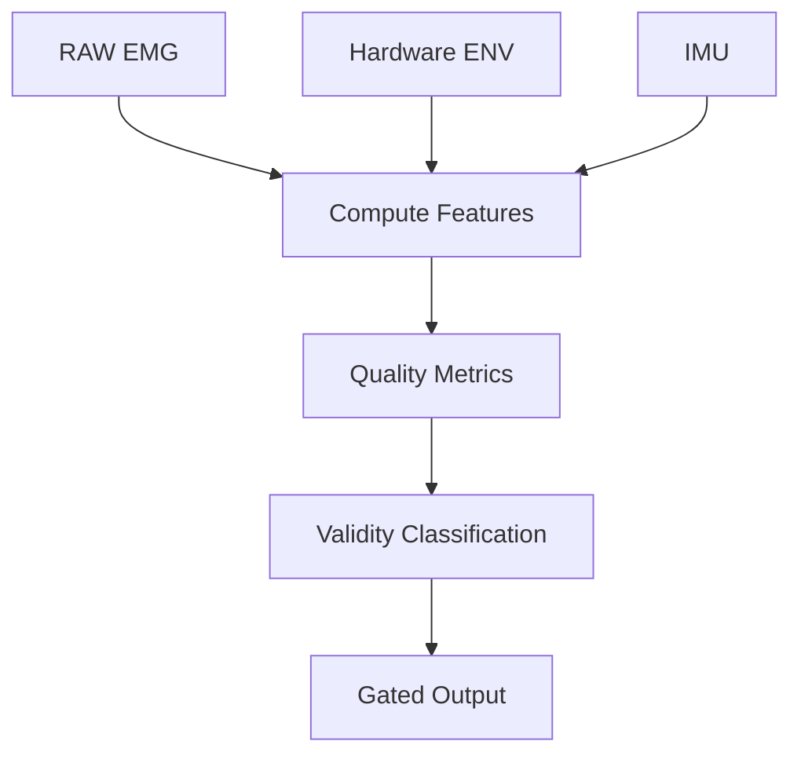

Below is a practical step-by-step path I would follow. I'll keep this in "inventor action plan" style, not legal advice. For patent strategy, especially because this may involve a minor participant, university collaborators, possible prior/public disclosures, and your employer's IP policy, you should review with a registered patent attorney or your organization's invention-disclosure process before filing.

## Executive recommendation

Your best next move is **not** to file a broad "EMG/IMU fatigue monitoring" provisional. Instead, build a focused invention disclosure around:

> **Reliability-gated wearable EMG monitoring using simultaneous RAW EMG, hardware envelope, and IMU context to validate, delay, down-weight, correct, or annotate downstream fatigue/activation metrics.**

That framing is strongly supported by your two drafts: [icpics_draft.pdf](https://qualcomm-my.sharepoint.com/personal/wangx_qti_qualcomm_com/Documents/Microsoft%20Copilot%20Chat%20Files/icpics_draft.pdf?EntityRepresentationId=6990eae1-ada8-4441-9e42-b5c6d150b83e) describes the dual RAW/ENV hardware, synchronized 2 kHz EMG + 200 Hz IMU platform, BLE timing/reconnect handling, and pogo-pin ghost-signal failure diagnostic; [paper_cnib.pdf](https://qualcomm-my.sharepoint.com/personal/wangx_qti_qualcomm_com/Documents/Microsoft%20Copilot%20Chat%20Files/paper_cnib.pdf?EntityRepresentationId=9d1874c1-d9cf-4cb3-83b6-8953fa3e4b52) describes the trustworthiness-first fatigue interpretation framework, electrode settling, contact-quality metric, IMU-conditioned interpretation, and session-gap artifact detection.

***

# Step 0 — Decide ownership / disclosure constraints first

Before drafting too much, clarify **who owns or must be notified**.

Because you work at Qualcomm and this project touches sensing, wearable signal processing, BLE, IMU, and fatigue monitoring, you should check whether the invention is considered personal, university/student work, company-related, or jointly owned. I cannot determine that from the files. The project itself lists Ryan Wang, Theodore (Teddy) Di, and Dr. YanMing Di on paper_cnib.pdf, and icpics_draft.pdf lists Ryan Wang and Dr. YanMing Di.

**Action items**

1. Make a simple inventor/contributor table:
   * Who conceived each idea?
   * Who implemented each idea?
   * Who only validated, advised, tested, or wrote?
2. Separate:
   * **Inventors**: people who contributed to the claimed inventive concepts.
   * **Authors / testers / advisors**: important, but not necessarily inventors.
3. Check:
   * Qualcomm employee invention policy.
   * Any university / professor involvement terms.
   * Any science fair, paper submission, poster, or public disclosure dates.
   * Whether any code/data was shared publicly.

**Important:** Inventorship is a legal determination. Do not guess. Make the evidence table, then let counsel decide.

***

# Step 1 — Freeze the public-disclosure timeline

This is urgent because patents are first-to-file, and public disclosures can affect rights.

Your icpics_draft.pdf references an earlier poster by R. Wang, "Low-cost wearable kit and algorithms to predict and prevent muscle overuse injuries," at the 102nd Annual Meeting, AAAS Pacific Division, University of San Diego, June 17–20, 2024. That may or may not disclose the same invention. You need to compare it against the proposed patent focus.

**Action items**

Create a file like:

```text
patent_public_disclosure_timeline.md
```

Include:

```markdown
# Public / Semi-Public Disclosure Timeline

## Known disclosures
| Date | Disclosure | Audience | Public? | What technical details were disclosed? | Related to RAW/ENV/IMU validity gating? |
|---|---|---|---|---|---|
| 2024-06-17 to 2024-06-20 | AAAS Pacific Division poster | Conference | TBD | Low-cost wearable kit and algorithms to predict/prevent overuse injuries | TBD |
| TBD | ICPICS draft / submission | TBD | TBD | BLE platform, RAW/ENV, pogo-pin ghost signal | TBD |
| TBD | CNIB draft / submission | TBD | TBD | EMG validity, settling, IMU-conditioned interpretation | TBD |
| TBD | GitHub / code / markdown | TBD | TBD | TBD | TBD |
```

For each disclosure, answer: **Did it disclose the specific combination of RAW/ENV consistency + IMU context + validity gating?**

If not, your newer invention may still be separable. If yes, counsel needs dates.

***

# Step 2 — Split the invention into "claim families"

Do not try to put everything into one blob. Create several invention families, then decide which one is strongest for the first provisional.

## Family A — strongest: RAW/ENV/IMU signal-quality validation

This is your main provisional candidate.

Supported by:

* MyoWare 2.0 has both ENV and RAW outputs; RAW is needed for spectral analysis, while ENV provides a paired signal from the same EMG sensor path.
* paper_cnib.pdf states the system uses RAW EMG for MDF/MNF and an IMU as an independent biomechanical context channel rather than a fused feature.
* paper_cnib.pdf explicitly frames field sEMG monitoring as requiring settling-aware baselines, contact-quality monitoring, IMU-conditioned interpretation, and continuity auditing.

**Core invention:** A system computes a RAW-derived envelope/amplitude feature, compares it with hardware ENV and IMU context, and gates downstream EMG interpretation.

## Family B — baseline selection and fatigue gating

Supported by:

* paper_cnib.pdf shows warmup-skip sensitivity: 10-, 15-, and 20-minute skips produced different fatigue conclusions, including −2.6%, −26.2%, and +28.1% MDF change.
* paper_cnib.pdf says baseline selection is a first-order determinant of fatigue interpretation.

**Core invention:** A baseline selector accepts only windows satisfying EMG quality, RAW/ENV consistency, IMU stability, and continuity conditions.

## Family C — session continuity / BLE gap validity audit

Supported by:

* paper_cnib.pdf reports that log0303 had a 66-minute BLE reconnection gap, where a full-session apparent 28.7% MDF drop was reduced to 4.9% when considering the first continuous segment alone.
* icpics_draft.pdf describes hybrid `abs_us` reconstruction across reconnects/device resets and detection of session discontinuities.

**Core invention:** EMG fatigue interpretation is segmented or suppressed across wireless discontinuities.

## Family D — pogo-pin / ghost-channel diagnostic

Supported by:

* icpics_draft.pdf reports RAW routed through pogo pins failed under movement, producing a floating ADC input that tracked ENV due to ADC multiplexer charge sharing; the diagnostic signature included Pearson r = 0.998 vs. ENV, near-zero RAW variance, and post-filter flatline, fixed by solder bypass.
* paper_cnib.pdf also states the RAW signal was routed by direct solder bypass after a field-discovered pogo-pin routing failure produced a ghost signal indistinguishable by eye but flatlined after preprocessing.

**Core invention:** A diagnostic method for detecting ghost-channel analog coupling or floating ADC input in multiplexed wearable biosignal acquisition.

**My recommendation:** Put all four families into one strong provisional if cost/effort allows, but make **Family A** the title and main independent concept. Families B–D become dependent embodiments.

***

# Step 3 — Draft a one-page invention disclosure first

Before writing a long provisional, create a crisp internal invention disclosure. This will help you talk to a patent attorney or company IP reviewer.

Use this structure:

```markdown
# Invention Disclosure: Reliability-Gated Wearable EMG Monitoring Using RAW/ENV/IMU Consistency

## 1. Short title
Systems and Methods for Signal-Quality Validation of Wearable Electromyography Using Simultaneous Raw EMG, Hardware Envelope, and Inertial Context

## 2. Problem
Wearable EMG fatigue metrics in field sports can be corrupted by electrode settling, contact degradation, hardware envelope saturation, raw-channel failure, motion artifact, and wireless discontinuities.

## 3. Key insight
Instead of treating EMG features as automatically valid, the system first determines whether EMG-derived fatigue or activation metrics are trustworthy by comparing simultaneously acquired RAW EMG, hardware ENV, and IMU/session context.

## 4. Technical solution
The system:
1. receives high-rate RAW EMG;
2. receives low-rate or paired hardware ENV from the same sensor;
3. receives IMU data;
4. computes RAW-derived RMS/envelope/spectral features;
5. compares RAW-derived amplitude/envelope features against hardware ENV;
6. detects saturation, flatline, contact settling, ghost-channel coupling, motion artifact, and session-gap confounds;
7. gates downstream fatigue/activation metrics by accepting, rejecting, delaying, down-weighting, correcting, or annotating them.

## 5. Evidence / embodiments
- RAW/ENV paired MyoWare acquisition.
- RAW-derived spectral MDF/MNF.
- IMU-conditioned validity matrix.
- Warmup-skip sensitivity.
- Contact-quality metric.
- BLE gap artifact.
- Pogo-pin ghost signal diagnostic.

## 6. Commercial / practical value
Improves reliability of low-cost field EMG monitoring in sports, rehab, occupational monitoring, gesture interfaces, and human-performance tracking.
```

***

# Step 4 — Write the provisional as a technical document, not just "claims"

A provisional application does **not** need formal claims, oath/declaration, or information disclosure statement, according to the USPTO. It can establish an early filing date for a later nonprovisional, and "patent pending" may be used after filing. But it must still describe the invention with enough technical detail to support later claims. The USPTO states the provisional lasts 12 months and that the 12-month period cannot be extended; a corresponding nonprovisional must be filed during that period to benefit from the provisional filing date.

**Recommended provisional document structure**

```markdown
# Systems and Methods for Signal-Quality Validation of Wearable Electromyography Using Simultaneous Raw EMG, Hardware Envelope, and Inertial Context

## 1. Field
Wearable biosignal acquisition, electromyography, inertial sensing, sports monitoring, rehabilitation, occupational ergonomics, and sensor signal-quality validation.

## 2. Background
- Wearable EMG is sensitive to electrode settling, motion artifact, contact drift, channel failure, envelope saturation, wireless gaps.
- Existing EMG/IMU systems often focus on activity/fatigue classification, not validity gating.
- Field sports require minimal preparation and no-gel electrodes.

## 3. Summary
A system validates EMG trustworthiness before downstream fatigue or activation interpretation by using simultaneous RAW EMG, hardware ENV, and IMU/session context.

## 4. System architecture
- EMG sensor with RAW and ENV outputs.
- IMU.
- Processor / MCU.
- Wireless link.
- Host / mobile / cloud processor.
- Optional display/warning interface.

## 5. RAW-derived envelope computation
- DC midpoint estimation.
- Rectification around midpoint.
- Low-pass filtering.
- Scaling/normalization to hardware ENV.
- Shape/timing/correlation comparison.

## 6. Signal-quality metrics
Table of metrics.

## 7. Failure-mode classification
Table of classes.

## 8. IMU-conditioned validity logic
Decision matrix.

## 9. Baseline selection and fatigue gating
- settling-aware baseline.
- quality-gated baseline candidates.
- delayed baseline initialization.
- confidence score.

## 10. Session continuity logic
- BLE disconnect/gap detection.
- segment separation.
- cross-segment suppression.

## 11. Hardware failure diagnostic embodiment
- ghost-channel correlation.
- near-zero variance.
- post-filter flatline.
- solder bypass / routing repair.

## 12. Example tennis embodiments
- log0305.
- log0303.
- qualitative and quantitative evidence.

## 13. Variations
- other sports.
- rehab.
- workplace ergonomics.
- multi-muscle arrays.
- other biosignals.
- phone/watch implementation.
- cloud/offline processing.
- different envelope rates.

## 14. Advantages
- prevents false fatigue conclusions.
- improves baseline quality.
- detects contact and hardware failures.
- works in field settings.
- uses low-cost sensors.

## 15. Claim concepts
Non-formal claim sketches.
```

***

# Step 5 — Build the "invention figures" now

Even if a provisional does not always require drawings, your invention is easier to protect if you include clear diagrams. The USPTO cover sheet itself has fields for specification pages and drawing sheets, and the USPTO provisional cover sheet identifies the filing as a provisional application under 37 CFR 1.53(c).

Create 6–8 simple figures:

## Figure 1 — System block diagram

```text
EMG Sensor
  ├── RAW output ─────┐
  └── ENV output ─────┤
                      ├── MCU / Processor ── BLE/Wired ── Host/Mobile
IMU ──────────────────┘

Host/Mobile:
  RAW envelope computation
  RAW/ENV consistency metrics
  IMU context classifier
  Quality gate
  Fatigue / activation feature output
```

## Figure 2 — Method flow

```text
Acquire RAW, ENV, IMU
        ↓
Preprocess RAW
        ↓
Compute software envelope / RMS / spectral features
        ↓
Compare RAW-derived envelope with hardware ENV
        ↓
Compute IMU context and continuity state
        ↓
Classify signal validity
        ↓
Accept / reject / delay / down-weight / correct / annotate fatigue metrics
```

## Figure 3 — RAW/ENV consistency logic

Show:

* normal case
* ENV saturation
* RAW flatline
* ghost-channel coupling
* contact settling

## Figure 4 — IMU-conditioned interpretation matrix

Use the matrix from paper_cnib.pdf, which distinguishes stable swing intensity with early low MDF recovery, stable swing intensity with gradual post-settling MDF/MNF decline, declining swing intensity with MDF decline, large IMU shock with isolated EMG outlier, and BLE/session discontinuity with EMG baseline shift.

## Figure 5 — Baseline gating

```text
Candidate baseline windows
        ↓
Quality filters:
  RAW variance OK?
  ENV saturation below threshold?
  RAW/ENV consistency OK?
  contact quality above threshold?
  IMU context stable?
  no session gap?
        ↓
Accepted baseline pool
        ↓
Median/robust baseline MDF/RMS
```

## Figure 6 — Pogo-pin ghost diagnostic

Use the evidence from icpics_draft.pdf: pre-bypass high ENV–RAW correlation, near-zero RAW variance, post-filter flatline, and post-bypass independent RAW oscillation.

## Figure 7 — Session discontinuity logic

Use the log0303 case from paper_cnib.pdf: full-session apparent 28.7% MDF drop versus 4.9% within the first continuous segment, separated by a 66-minute BLE reconnection gap.

***

# Step 6 — Create a metrics table for the provisional

Use a table like this. This is not legal claim language; it is technical support for later claims.

| Metric                                  | Source             | Purpose                              | Possible gate/action                  |
| --------------------------------------- | ------------------ | ------------------------------------ | ------------------------------------- |
| RAW RMS                                 | RAW EMG            | amplitude/contact/activation context | reject low-SNR baseline               |
| RAW software envelope                   | RAW EMG            | compare with hardware ENV            | detect mismatch or failure            |
| Hardware ENV mean/max                   | ENV                | envelope/contact/saturation context  | flag ENV saturation                   |
| RAW/ENV correlation                     | RAW + ENV          | detect coupling or consistency       | detect ghost channel or mismatch      |
| RAW variance                            | RAW                | detect flatline / floating input     | reject window/session                 |
| ENV saturation count/%                  | ENV                | detect clipping                      | reduce ENV trust                      |
| Contact quality = RMS/session_p90_rms   | RAW-derived RMS    | qualitative contact indicator        | delay baseline or annotate confidence |
| IMU peak gyro magnitude                 | IMU                | swing intensity context              | distinguish fatigue vs effort         |
| IMU shock/jerk                          | IMU                | motion artifact context              | down-weight outlier                   |
| Session continuity / `abs_us` gap       | host/device timing | gap artifact detection               | segment analysis                      |

The contact-quality metric `contact_quality(t) = RMS(t) / session_p90_rms` is explicitly described in paper_cnib.pdf as a qualitative relative indicator, not validated against direct impedance. The hybrid `abs_us` timeline and reconnect handling are described in icpics_draft.pdf.

***

# Step 7 — Draft claim concepts, but keep them broad enough

Even though formal claims are not required for a provisional, include "claim concepts" so the later attorney has clear scope.

## Independent method concept

```text
A method comprising:
receiving raw electromyography samples from a wearable electromyography sensor;
receiving hardware envelope samples acquired from the wearable electromyography sensor;
receiving inertial measurement samples from a wearable inertial sensor;
computing a raw-derived amplitude or envelope feature from the raw electromyography samples;
generating one or more signal-quality metrics by comparing the raw-derived amplitude or envelope feature with the hardware envelope samples;
determining an inertial context from the inertial measurement samples;
classifying a trustworthiness state of one or more electromyography windows based on the signal-quality metrics and the inertial context; and
modifying downstream interpretation of electromyography-derived activation or fatigue metrics based on the trustworthiness state.
```

## Dependent concept examples

```text
The method of claim 1, wherein modifying downstream interpretation comprises accepting, rejecting, delaying, down-weighting, correcting, segmenting, or annotating an EMG-derived fatigue metric.

The method of claim 1, wherein the signal-quality metrics comprise at least one of RAW variance, RAW/ENV correlation, ENV saturation percentage, RAW-derived RMS, RAW-derived software envelope, hardware ENV maximum, or RAW/ENV ratio.

The method of claim 1, wherein the inertial context identifies stable movement intensity, declining movement intensity, transient shock, vibration, or motion discontinuity.

The method of claim 1, wherein a baseline window is accepted only if the signal-quality metrics and inertial context satisfy one or more quality conditions.

The method of claim 1, wherein a ghost-channel failure is detected based on high correlation between RAW and ENV, near-zero RAW variance, and a flatline after bandpass filtering.
```

This maps well to your actual evidence without overclaiming.

***

# Step 8 — Add experimental examples carefully

Use your data as **examples**, not as limitations.

Good language:

> In one embodiment, a tennis forearm EMG–IMU system was used. In a continuous 63.1-minute session with 626 detected swings, the system observed a three-phase MDF trajectory: early low MDF attributed to electrode settling, mid-session settled reference, and later fatigue-consistent decline while IMU swing intensity remained stable.

This is supported by paper_cnib.pdf, which reports a 63.1-minute continuous tennis session with 626 swings, a three-phase MDF trajectory, and stable IMU swing intensity with r = +0.029 and p = 0.468.

Good language:

> In another embodiment, session continuity auditing prevented a false fatigue conclusion where a 66-minute BLE reconnection gap produced an apparent full-session MDF drop of 28.7%, while the first continuous segment alone showed 4.9% change.

This is directly supported by paper_cnib.pdf.

Good language:

> In another embodiment, a RAW-channel routing failure was detected using a high RAW–ENV correlation, near-zero RAW variance, and post-filter RAW flatline, and was repaired using a solder bypass.

This is supported by icpics_draft.pdf, which reports Pearson r = 0.998 vs. ENV before repair, near-zero variance, post-filter flatline, and post-bypass filtered ENV–RAW correlation of r = −0.013.

Avoid saying:

> This proves fatigue.

Your own paper_cnib.pdf correctly says the findings are **fatigue-consistent**, not physiologically confirmed, because there was no MVC, RPE, grip-force, or ball-speed ground truth.

***

# Step 9 — Perform a focused prior-art search

You do not need a perfect patentability search before filing a provisional, but you should understand the landscape.

Search categories:

1. **EMG signal quality analysis**
   * sEMG signal quality index
   * electrode contact quality EMG
   * dry electrode impedance EMG
   * EMG artifact detection

2. **EMG envelope + raw signal**
   * hardware envelope raw EMG comparison
   * MyoWare raw envelope validation
   * dual-output EMG signal quality

3. **IMU-conditioned EMG validity**
   * IMU motion artifact EMG detection
   * EMG IMU artifact suppression
   * wearable EMG IMU fatigue validation

4. **Baseline selection / warmup gating**
   * EMG fatigue baseline selection
   * median frequency baseline warmup
   * dry electrode settling EMG fatigue

5. **Wireless continuity / session gap**
   * wearable biosignal BLE discontinuity artifact
   * EMG fatigue session gap detection

6. **ADC ghost channel / multiplexed ADC crosstalk**
   * multiplexed ADC charge sharing biosignal
   * floating ADC input channel coupling
   * EMG raw envelope crosstalk diagnostic

Your paper_cnib.pdf already cites a review of sEMG signal quality analysis and a review on reducing noise/artifacts/interference in single-channel EMG signals, which are likely important prior-art starting points. Your icpics_draft.pdf also cites prior low-cost EMG systems and commercial EMG systems, useful for background.

***

# Step 10 — Decide whether to file DIY provisional or attorney-prepared provisional

## DIY provisional may be acceptable if:

* You need a quick priority date.
* The invention is still evolving.
* You will later have counsel prepare the nonprovisional.
* You include enough detail, variations, figures, algorithms, thresholds, and examples.

## Attorney-prepared is better if:

* There may be employer/university ownership.
* The invention may become commercially important.
* You plan to publish soon.
* You want stronger claim support.
* There are multiple inventors, including a minor.
* You want international filing options.

The USPTO says a provisional application does not need a formal patent claim, oath/declaration, or information disclosure statement, but it also states the provisional only lasts 12 months and must be followed by a corresponding nonprovisional during that period to benefit from the provisional filing date. The USPTO utility filing guide also notes that a patent application is a complex legal document and may be best prepared by someone trained to prepare such documents.

***

# Step 11 — Filing checklist

For a U.S. provisional, the USPTO describes three practical components: written description/specification, cover sheet, and fee. The USPTO provisional cover sheet identifies it as a request for filing a provisional application and includes inventor information, title, correspondence address, application parts, and fee information. The USPTO provisional page states that a provisional does not require formal claims, oath/declaration, or an information disclosure statement.

## Package to prepare

```text
1. Specification PDF
   patent_raw_env_imu_signal_quality.pdf

2. Drawings PDF
   patent_raw_env_imu_signal_quality_figures.pdf
   or figures embedded in the specification

3. Provisional cover sheet
   PTO/SB/16

4. Fee payment
   Large/small/micro entity as applicable

5. Optional internal record
   inventor_contribution_table.md
   disclosure_timeline.md
   prior_art_notes.md
```

The USPTO cover sheet snippet lists provisional filing fees of $325 large entity, $130 small entity, and $65 micro entity, and notes additional application size fees if the specification and drawings exceed 100 sheets. Micro entity status has requirements; the USPTO states applicants/patentees must establish micro entity status and that, as of September 9, 2025, the maximum qualifying gross income changed to $251,190 for the gross-income basis.

***

# Step 12 — After filing, manage the 12-month clock

Once filed, immediately create a follow-up plan.

The USPTO states that the provisional pendency lasts 12 months from filing and that the 12-month period cannot be extended; a corresponding nonprovisional must be filed during that period to benefit from the provisional filing date. The USPTO also states that a nonprovisional filed more than 12 months but within 14 months may have the benefit restored by a grantable petition if the delay was unintentional and the required petition fee is paid. Do not rely on restoration as a plan.

Create:

```text
patent_followup_plan.md
```

Include:

```markdown
# Patent Follow-Up Plan

## Filing date
TBD

## 12-month nonprovisional deadline
TBD

## Before publication / conference submission
- Confirm provisional filed.
- Confirm inventor list.
- Confirm ownership/assignment.
- Confirm no new material omitted.

## During the 12-month period
- Add more sessions / subjects if available.
- Implement real-time quality gate.
- Add live warning UI.
- Validate RAW/ENV thresholds.
- Add impedance if available.
- Prepare nonprovisional claims.
```

***

# Step 13 — What to implement next technically

From a patent-strength perspective, the best next technical work is not just more fatigue analysis. It is turning the validity concept into a concrete algorithm.

## Implement a `quality_gate.py` or equivalent

Inputs:

```text
RAW EMG
Hardware ENV
IMU
session timeline / abs_us
BLE segment IDs
```

Outputs:

```text
quality_state
confidence_score
failure_flags
recommended_action
```

Example states:

```python
VALID = "valid_emg"
SETTLING = "electrode_settling"
LOW_SNR = "contact_loss_or_low_snr"
ENV_SAT = "hardware_env_saturation"
RAW_FLATLINE = "raw_channel_flatline"
GHOST = "ghost_channel_coupling"
MOTION_ARTIFACT = "motion_artifact_likely"
REDUCED_MOTION_CONFOUND = "reduced_motion_confound"
SESSION_GAP = "session_gap_confound"
```

Example actions:

```python
ACCEPT
REJECT
DELAY_BASELINE
DOWN_WEIGHT
SEGMENT_SEPARATELY
SUPPRESS_FATIGUE_OUTPUT
SHOW_CONFIDENCE_WARNING
PROMPT_ELECTRODE_ADJUSTMENT
```

This will make the provisional stronger because it shows the invention is not just an observation; it is a system and method.

***

# Step 14 — Be careful with wording

Use precise patent-friendly wording:

## Prefer

* "trustworthiness"
* "validity gating"
* "confidence score"
* "modifying downstream interpretation"
* "accepting, rejecting, delaying, down-weighting, correcting, segmenting, or annotating"
* "IMU as independent context"
* "RAW/ENV consistency"
* "hardware envelope as quality/context signal"
* "session continuity audit"

## Avoid over-narrowing

Avoid saying only:

* tennis
* MyoWare
* ESP32
* 2 kHz
* 200 Hz
* 20-minute threshold
* BLE only
* forearm only
* MDF only

Instead:

> In some embodiments…

Then include:

* other muscles
* other sports
* rehab
* workplace ergonomics
* wired or wireless
* different sample rates
* different envelope rates
* phone, watch, microcontroller, cloud
* multiple EMG channels
* impedance sensor optional
* ECG/EEG/other biosignal variants if appropriate

***

# Step 15 — Suggested immediate file set

I would create these files in your project:

```text
/local/mnt/workspace/wangx/projects/emg_util/patent/
  01_invention_disclosure_raw_env_imu_quality.md
  02_public_disclosure_timeline.md
  03_inventor_contribution_matrix.md
  04_prior_art_search_notes.md
  05_provisional_draft_raw_env_imu_quality.md
  06_figures/
      fig1_system_architecture.md
      fig2_method_flow.md
      fig3_raw_env_consistency.md
      fig4_imu_decision_matrix.md
      fig5_baseline_gating.md
      fig6_ghost_signal_diagnostic.md
      fig7_session_gap_audit.md
  07_claim_concepts.md
  08_attorney_review_questions.md
```

***

# A concrete step-by-step plan for you

## Phase 1 — Clean invention scope

1. Write the one-page invention disclosure.
2. Create inventor contribution matrix.
3. Create public disclosure timeline.
4. Decide whether this is personal, university, joint, or employer-reportable.
5. Freeze current code/data/docs as evidence.

## Phase 2 — Draft provisional

6. Draft specification using the structure above.
7. Add figures.
8. Add example embodiments:
   * RAW/ENV paired acquisition.
   * IMU-conditioned validity.
   * baseline gating.
   * session continuity.
   * ghost-channel diagnostic.
9. Add variation section.
10. Add claim concepts.

## Phase 3 — Review before filing

11. Review for overclaiming:

* say "fatigue-consistent," not "proved fatigue," unless ground truth supports it.

12. Review for under-disclosure:

* include algorithms, thresholds, alternatives, pseudocode, failure states.

13. Review ownership/inventorship with counsel/company/university as needed.
14. Run focused prior-art search.
15. Update the provisional with differentiators.

## Phase 4 — File

16. Convert to PDF.
17. Prepare USPTO provisional cover sheet.
18. Confirm entity status and fee.
19. File via USPTO Patent Center or through counsel.
20. Save receipt, application number, filing date, and exact submitted PDF.

## Phase 5 — After filing

21. Mark materials "patent pending" only after filing.
22. Track 12-month nonprovisional deadline.
23. Continue experiments and real-time implementation.
24. Before any paper/poster/code release, check whether new matter should be added in a second provisional.
25. Prepare nonprovisional claims well before the 12-month deadline.

***

# My suggested next writing target

The first artifact I'd write is:

```text
patent/01_invention_disclosure_raw_env_imu_quality.md
```

with this title:

> **Reliability-Gated Wearable EMG Monitoring Using RAW/Envelope Consistency and IMU-Based Validity Context**

Then turn that into:

```text
patent/05_provisional_draft_raw_env_imu_quality.md
```

The most important thing is to make the provisional describe **decision logic**, not just the hardware and experiment. Your patentable center of gravity is the **trustworthiness gate**:

```text
RAW EMG → physiology candidate
ENV → hardware/contact/saturation consistency
IMU → movement/artifact/context
session timeline → continuity validity
quality gate → confidence/action for fatigue interpretation
```

That is the cleanest, strongest story.

***

# Next Steps Before Filing the Provisional Patent Application

## 🚀 Recommended High-ROI Next Step

Before filing the provisional patent application, add **5–7 simple figures** to the draft.

These figures do not need to be polished at the beginning. They can be:

- Hand-drawn sketches
- Simple PowerPoint diagrams
- Markdown/ASCII diagrams
- Block diagrams
- Flowcharts
- Decision tables
- Annotated plots from existing experiments

The goal is not visual beauty. The goal is to make the invention easier to understand and harder to misinterpret later.

---

## Why Figures Matter

Adding figures can significantly strengthen the provisional application because they help support:

### 1. Claim Scope

Figures make it easier to show that the invention is not limited to a single implementation.

For example, a figure can show that the method applies broadly to:

- Different EMG sensors
- Different IMU sensors
- Real-time or offline processing
- Embedded, phone, PC, or cloud-based analysis
- Sports, rehabilitation, and occupational monitoring

This helps avoid making the invention look too narrowly tied to one tennis experiment, one MyoWare sensor, or one ESP32 prototype.

---

### 2. Enablement

Figures help demonstrate how a person skilled in the field could implement the invention.

They can show:

- What signals are acquired
- How RAW EMG, hardware ENV, and IMU are combined
- How quality metrics are computed
- How validity states are classified
- How downstream fatigue or activation metrics are gated

This is especially important because the invention is not just a sensor, and not just a fatigue metric. The key invention is the **decision logic that determines whether EMG-derived metrics are trustworthy**.

---

### 3. Examiner / Attorney Interpretation

A future patent attorney, patent examiner, or reviewer will understand the invention faster if the core logic is visual.

Figures reduce ambiguity around questions such as:

- What is the relationship between RAW EMG and hardware ENV?
- How is IMU used as a validity context rather than a normal fusion feature?
- What does "gating" mean?
- What failure modes are detected?
- What actions are taken after signal-quality classification?

---

## Recommended Figures to Add

### Figure 1 — System Architecture

Show the main hardware and software components.

```text
EMG Sensor
  ├── RAW output ─────┐
  └── ENV output ─────┤
                      ├── Processor / MCU ── Wireless/Wired Link ── Host or Mobile Device
IMU Sensor ───────────┘

Host / Mobile Processing:
  RAW preprocessing
  RAW-derived envelope
  RAW/ENV consistency check
  IMU context analysis
  Signal-quality classifier
  Fatigue / activation gating
  Confidence-aware output
```

**Purpose:** Shows that the system is not just hardware; it includes decision logic.

---

### Figure 2 — Method Flow (High-Level)

```text
┌─────────────────────────────────────────────────────────────┐
│ Acquire: RAW EMG, Hardware ENV, IMU, Session Timestamp     │
└────────────────────┬────────────────────────────────────────┘
                     ↓
┌─────────────────────────────────────────────────────────────┐
│ Compute Features:                                           │
│  • RAW-derived RMS, envelope, spectral (MDF/MNF)           │
│  • Hardware ENV amplitude, saturation                       │
│  • IMU motion intensity, shock/jerk                         │
└────────────────────┬────────────────────────────────────────┘
                     ↓
┌─────────────────────────────────────────────────────────────┐
│ Generate Signal-Quality Metrics:                            │
│  • RAW/ENV consistency (correlation, ratio)                │
│  • RAW variance / flatline detection                        │
│  • ENV saturation indicators                               │
│  • Contact-quality metric                                  │
│  • Session continuity check                                │
└────────────────────┬────────────────────────────────────────┘
                     ↓
┌─────────────────────────────────────────────────────────────┐
│ Classify Signal Validity State:                             │
│  Valid | Settling | Low-SNR | Saturation | Flatline |      │
│  Ghost | Motion Artifact | Reduced Motion | Session Gap    │
└────────────────────┬────────────────────────────────────────┘
                     ↓
┌─────────────────────────────────────────────────────────────┐
│ Modify Downstream Interpretation:                           │
│  Accept / Reject / Delay / Down-weight / Segment / Annotate│
│  Generate confidence score and user feedback               │
└─────────────────────────────────────────────────────────────┘
```

**Purpose:** Shows the complete decision pipeline from raw data to gated output.

---

### Figure 3 — RAW/ENV Consistency Logic

Create a table or diagram showing different scenarios:

| Scenario | RAW Behavior | ENV Behavior | RAW/ENV Correlation | Interpretation |
|----------|-------------|-------------|-------------------|-----------------|
| Normal | Oscillating | Smooth envelope | Moderate (0.3–0.7) | Valid EMG |
| Settling | Low amplitude, recovering | Smooth | Moderate | Electrode settling |
| Saturation | Clipped | Clipped | High (>0.9) | Hardware saturation |
| Flatline | Near-zero variance | Normal | Very high (>0.95) | Raw channel failure / ghost signal |
| Contact loss | Low amplitude | Low amplitude | Moderate | Low SNR / poor contact |

**Purpose:** Shows how RAW/ENV comparison detects specific failure modes.

---

### Figure 4 — IMU-Conditioned Validity Matrix

Use a decision table showing how IMU context disambiguates EMG observations:

| IMU Context | EMG Observation | Interpretation | Action |
|------------|----------------|-----------------|--------|
| Stable motion | Early low MDF, recovering | Electrode settling | Delay baseline |
| Stable motion | Gradual MDF decline | Fatigue-consistent | Accept |
| Declining motion | MDF decline | Reduced effort confound | Down-weight |
| High shock/jerk | Isolated EMG spike | Motion artifact | Reject window |
| Session discontinuity | Baseline shift | Cross-segment artifact | Segment separately |

**Purpose:** Shows how IMU is used as independent context, not as a fused feature.

---

### Figure 5 — Baseline Selection Gating

```text
Candidate Baseline Windows
        ↓
┌─────────────────────────────────────────┐
│ Quality Filters (ALL must pass):        │
│  ✓ RAW variance > threshold?            │
│  ✓ ENV saturation < threshold?          │
│  ✓ RAW/ENV correlation in range?        │
│  ✓ Contact quality > threshold?         │
│  ✓ IMU context stable?                  │
│  ✓ No session gap?                      │
└────────────┬────────────────────────────┘
             ↓
        Accepted Baseline Pool
             ↓
    Median/Robust Baseline MDF/RMS
             ↓
    Downstream Fatigue Interpretation
```

**Purpose:** Shows that baseline is not arbitrary; it is quality-gated.

---

### Figure 6 — Ghost-Channel Diagnostic

Show the pogo-pin failure case:

```text
Before Repair (Ghost Signal):
  RAW–ENV correlation: r = 0.998 (very high)
  RAW variance: near-zero
  RAW post-filter: flatline
  Diagnosis: Floating ADC input coupled to ENV

After Repair (Solder Bypass):
  RAW–ENV correlation: r = −0.013 (independent)
  RAW variance: normal
  RAW post-filter: oscillating
  Diagnosis: Valid independent RAW channel
```

**Purpose:** Shows a concrete hardware failure detection example.

---

### Figure 7 — Session Discontinuity Logic

Use the log0303 case:

```text
Full Session (66-minute BLE gap):
  Apparent MDF drop: 28.7%
  Interpretation: Fatigue? (WRONG)

Segment 1 (before gap):
  MDF drop: 4.9%
  Interpretation: Fatigue-consistent ✓

Segment 2 (after gap):
  Baseline shift: +24% (non-physiological)
  Interpretation: Session artifact

Action: Analyze segments separately, suppress cross-segment fatigue metric
```

**Purpose:** Shows how session continuity prevents false fatigue conclusions.

---

## How to Create These Figures

### Option 1: Markdown/ASCII (Fastest)

Use ASCII art or markdown tables. These are easy to version-control and edit.

Example:

```markdown
## Figure 1 — System Architecture

[ASCII diagram here]
```

### Option 2: Simple Diagrams (Graphviz, Mermaid)

Use Graphviz or Mermaid syntax to generate diagrams:



### Option 3: Screenshots from Existing Data

If you have plots or visualizations from your tennis sessions, annotate them and include them as figures.

---

## Integration into the Provisional

Once you have the figures, integrate them into `patent_provisional_draft.md`:

1. Add a new section: **"7. FIGURES"** (after the system architecture section)
2. Embed or reference each figure
3. Add a brief caption explaining what each figure shows
4. Reference figures in the text where relevant (e.g., "As shown in Figure 2, the method comprises...")

---

## Timeline Estimate

- **Figure 1–2 (System & Method Flow):** 30 minutes
- **Figure 3–5 (Logic & Gating):** 45 minutes
- **Figure 6–7 (Concrete Examples):** 30 minutes
- **Integration into provisional:** 15 minutes

**Total: ~2 hours** to significantly strengthen the provisional.

---

## After Figures: Next Priority

Once figures are added, the next high-ROI task is:

1. **Add concrete experimental examples** (Section 12 in the provisional)
   - Use the tennis session data from your paper_cnib.pdf
   - Include specific numbers: session duration, swing count, MDF changes, IMU metrics
   - Show how the quality gate would have prevented false conclusions

2. **Create a simple `quality_gate.py` prototype** (Step 13 in the plan)
   - Implement the decision logic as pseudocode or actual Python
   - Show that the invention is not just an observation; it is a system and method
   - This strengthens enablement and claim scope

---

## Filing Readiness Checklist

Before filing, ensure:

- [ ] Invention disclosure is complete and reviewed
- [ ] Figures are added to the provisional
- [ ] Experimental examples are included with specific data
- [ ] Claim concepts are clear and broad enough
- [ ] Ownership/inventorship is resolved
- [ ] Public disclosure timeline is documented
- [ ] Prior-art search is complete
- [ ] Patent attorney has reviewed (if possible)
- [ ] USPTO cover sheet (PTO/SB/16) is prepared
- [ ] Filing fee is confirmed
- [ ] Provisional is converted to PDF
- [ ] Receipt and filing date are saved
